### Fierer Lab, University of Colorado Boulder

### Versions:

#### Version 1: October 2nd 2020 (presented by Cliff to CU Boulder CME)

#### Version 2: May 26, 2023 (presented by Nick in New Zealand)

#### Version 3: March 26, 2024 (shared to GitHub, shared with CU grad students)

#### Version 4: October 19, 2026

### This tutorial will cover mctoolsR and some commonly used alpha and beta diversity statistics and plotting. You can do many of the same things with the phyloseq package. We use mctoolsR mainly because it was designed by a former student in the Fierer Lab (Jon Leff) and our dada2 pipeline is set up to export into the format required.

### This tutorial was written with R 4.2.3, mctoolsR 0.1.1.9, and dplyr 1.1.3.

### It has been tested and is working with R 4.2.3, R 4.3.3, 4.5.1

# Setup

## Note the code below uses the example dataset from mctoolsR (<https://github.com/leffj/mctoolsr>). We will note where you can change the inputs and code to use your own data instead

    # R packages required for this tutorial
    suppressMessages(library(mctoolsr)) # For inputting, rarefying, filtering, taxonomic analyses
    suppressMessages(library(plyr)) # For hulls
    suppressMessages(library(tidyverse)) # For data manipulation and plotting
    suppressMessages(library(RColorBrewer)) # For color palettes
    suppressMessages(library(vegan)) # For alpha and beta diversity analyses
    suppressMessages(library(indicspecies)) # For indicator species
    suppressMessages(library(car)) # For Levene Test and ANOVA
    suppressMessages(library(PMCMRplus)) # For Nemenyi posthoc test
    suppressMessages(library(ggh4x)) # For nested facet plots
    suppressMessages(library(emmeans)) # For pairwise comparisons
    suppressMessages(library(multcomp)) # For automated significant difference letters
    suppressMessages(library(zCompositions)) # CLR
    suppressMessages(library(compositions)) # Aitchison
    suppressMessages(library(reshape2)) # For melting
    suppressMessages(library(cowplot)) # For plotting

    # Note: This tutorial was run with dplyr 1.1.3. If you are using a newer version of dplyr, you may need to install and load this version using:
    #install.packages("dplyr", version='1.1.3')
    #library(dplyr)

    # If you haven't already installed these packages before, you will need to install them with:
    # install.packages()

    # For Installing mctoolsR the first time, use:
    # install.packages("devtools")
    # devtools::install_github("leffj/mctoolsr")

    # Custom functions
    source("cliffplot_taxa_bars.R")
    source("plot_multipatt_asv.R")

# Loading Data

## This loads the mctoolsr example dataset.

    # Loading ASV Table
    tax_table_fp = system.file('extdata', 'fruits_veggies_taxa_table_wTax.biom', 
                               package = 'mctoolsr')

    # Loading mapping file
    map_fp = system.file('extdata', 'fruits_veggies_metadata.txt', 
                         package = 'mctoolsr')

    # To load YOUR OWN data, replace everything after the "=" with: 'PATH/TO/YOUR_ASV_TABLE_FILE.txt' <- output from dada2 pipeline
    # If your files are in your working directly, you do not need to specify the path

    # Combine the ASV table and mapping file into an mctoolsR object
    input = load_taxa_table(tax_table_fp, map_fp)

    ## 32 samples loaded

    # If this has worked correctly, you should get a note saying how many samples have been loaded. For the example dataset, this will say "32 samples loaded".

# Understanding the mctoolsR dataframe

## The mctoolsR object is a list with 3 dataframes that can be accessed with $. The dataframes are a sequence table, a mapping file, and a taxonomic file.

    # Examine the input dataframes.
    head(input$data_loaded) # Rows are OTUs (now ASVs), columns are samples

    ##        ProA12 ProA13 ProA14 ProA15 ProA16 ProA33 ProA34 ProA35 ProA36 ProA37 ProA58
    ## OTU_2       0      0      0      0      0      0      0      0      2      0      0
    ## OTU_3       0      0      0      0      0      1      0      0      0      0      0
    ## OTU_12      0      0      0      0      0      0      0      0      0      0      0
    ## OTU_13      0      1      0      0      0      0      0      0      0      0      0
    ## OTU_20      2      0      0      0      0      0      0      0      0      0      0
    ## OTU_25      0      0      0      0      1      0      0      0      0      0      0
    ##        ProA65 ProA66 ProB10 ProB12 ProB33 ProB34 ProB35 ProB36 ProB39 ProB40 ProB57
    ## OTU_2       0      0      0      0      0      0      0      0      0      0      0
    ## OTU_3       0      0      0      0      0      0      0      0      0      0      0
    ## OTU_12      0      0      0      0      0      0      0      0      0      0      1
    ## OTU_13      0      0      0      0      0      0      0      0      0      0      0
    ## OTU_20      0      0      0      0      0      0      0      0      0      0      0
    ## OTU_25      0      0      0      0      0      0      0      0      0      0      0
    ##        ProB58 ProB60 ProB67 ProB70 ProB71 ProB9 ProC36 ProC40 ProC65 ProC66
    ## OTU_2       0      0      0      0      0     0      0      0      0      0
    ## OTU_3       0      0      0      0      0     0      0      0      0      0
    ## OTU_12      0      0      0      0      0     0      0      0      0      0
    ## OTU_13      0      0      0      0      0     0      0      0      0      0
    ## OTU_20      0      0      0      0      0     2      0      0      0      0
    ## OTU_25      0      0      0      0      0     0      0      0      0      0

    head(input$taxonomy_loaded) # Rows are OTUs (now ASVs), columns are different taxonomic levels

    ##          taxonomy1         taxonomy2              taxonomy3            taxonomy4
    ## OTU_2  k__Bacteria p__Actinobacteria      c__Actinobacteria   o__Actinomycetales
    ## OTU_3  k__Bacteria p__Proteobacteria c__Gammaproteobacteria o__Enterobacteriales
    ## OTU_12 k__Bacteria     p__Firmicutes             c__Bacilli        o__Bacillales
    ## OTU_13  Unassigned      unclassified           unclassified         unclassified
    ## OTU_20 k__Bacteria p__Proteobacteria c__Gammaproteobacteria     o__Aeromonadales
    ## OTU_25  Unassigned      unclassified           unclassified         unclassified
    ##                    taxonomy5        taxonomy6    taxonomy7
    ## OTU_2  f__Pseudonocardiaceae g__Amycolatopsis          s__
    ## OTU_3  f__Enterobacteriaceae              g__          s__
    ## OTU_12        f__Bacillaceae      g__Bacillus          s__
    ## OTU_13          unclassified     unclassified unclassified
    ## OTU_20     f__Aeromonadaceae              g__          s__
    ## OTU_25          unclassified     unclassified unclassified

    head(input$map_loaded) # Rows are samples, columns are variables

    ##         Sample_type    Farm_type            Sample_Farming
    ## ProA12    Mushrooms Conventional    Mushrooms_Conventional
    ## ProA13    Mushrooms      Organic         Mushrooms_Organic
    ## ProA14    Mushrooms      Organic         Mushrooms_Organic
    ## ProA15    Mushrooms      Organic         Mushrooms_Organic
    ## ProA16    Mushrooms      Organic         Mushrooms_Organic
    ## ProA33 Strawberries Conventional Strawberries_Conventional

# Initial data examinination - reads per sample

## One of the first things we want to do is see how many sequences per sample there are.

    # This is done by getting the column sums of the sequence table, and we'll sort it too.
    sort(colSums(input$data_loaded))

    ## ProA37 ProB70 ProC66 ProB39 ProC40 ProB57 ProA12 ProA58 ProB34 ProC36 ProA65  ProB9 
    ##   1009   1011   1068   1152   1179   1192   1199   1216   1265   1313   1367   1371 
    ## ProB60 ProC65 ProB35 ProB10 ProB67 ProA66 ProB36 ProB71 ProB40 ProA36 ProB58 ProB33 
    ##   1395   1409   1492   1599   1611   1614   1642   1745   1771   1802   1860   2257 
    ## ProA16 ProA35 ProA33 ProB12 ProA13 ProA34 ProA15 ProA14 
    ##   2312   2530   2585   2642   2819   2982   3291   3390

    # We could also save this as an object and plot it
    seqcounts <- as.data.frame(sort(colSums(input$data_loaded)))

    # This puts the sample names as row names and the sequence counts column is titled "sort(colSums(input$data_loaded)))
    # We'll use the pipeline %>% which is very useful for dataframe management with the dplyr package
    # We'll rename the column and make a new column all at once
    seqcounts <- as.data.frame(sort(colSums(input$data_loaded))) %>%
      rename("seqs" = "sort(colSums(input$data_loaded))") %>%
      rownames_to_column(var = "sampleID")

    # Now we have a better dataframe with two columns, seqs and sampleID which we can plot
    ggplot(seqcounts, aes(reorder(sampleID, seqs, mean), seqs)) + # Dataframe and variables
      geom_bar(stat = "identity") + # Type of graph
      labs(y = "# Reads", x = "Sample") + # Axes labels
      coord_flip() + # Flip axes
      theme_classic() + # Plot style. I also use theme_bw() a lot.
      theme(axis.text.y = element_text(size = 10)) # Tweak things about text and legend in theme()

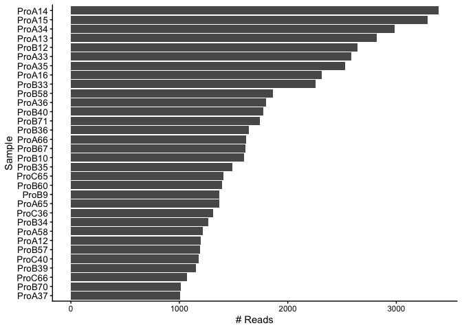

# Filtering data

## We often filter out anything not assigned to a phylum and any control samples. You may also want to do analyses on only a subset of your data, or remove contaminant ASVs that are found in the PCR or extraction blanks. For 16S, at the least filter out mitochondrial, chloroplast, eukaryote DNA, and things unassigned at phylum level. Depending on your samples and analysis goals, you should also consider filtering out extremely rare amplicon sequence variants. Here we will demonstrate removal of what are called “singletons” and “doubletons”, which are individual amplicon sequence variants that only appear once or twice, respectively, in the whole dataset. This is generally recommended.

    # Copy the dataset before doing any filtering
    input_filt <- input

    # For all filtering steps, taxa removed will be output, make note of this for methods section. Also sometimes it will say "Taxa not found" if it is not found. That is an error and the dataset will not be altered. The search is case sensitive.

    # This filters out any ASVs from input dataframe ("input_filt") not assigned to a phylum (at taxonomy level 2 = "NA") 
    input_filt <- filter_taxa_from_input(input_filt, 
                                         at_spec_level = 2, 
                                         taxa_to_remove = "unclassified") # 978

    ## 978 taxa removed

    # New versions call it NA
    #input_filt <- filter_taxa_from_input(input_filt, at_spec_level = 2, taxa_to_remove = "NA")

    # Filtering out mitochondria sequences from the filtered input dataset.
    input_filt <- filter_taxa_from_input(input_filt, 
                                         taxa_to_remove = "f__mitochondria") # 14 

    ## 14 taxa removed

    # New versions call it Mitochondria
    #input_filt <- filter_taxa_from_input(input_filt, taxa_to_remove = "Mitochondria")

    # Filtering out chloroplast sequences
    input_filt <- filter_taxa_from_input(input_filt, 
                                         taxa_to_remove = "c__Chloroplast") # 1

    ## 1 taxa removed

    # New versions call it Chloroplast
    #input_filt <- filter_taxa_from_input(input_filt, taxa_to_remove = "Chloroplast")  

    # Filtering out Eukaryotes
    #input_filt <- filter_taxa_from_input(input_filt, taxa_to_remove = "Eukaryota") # 0

    # If you want to filter out multiple groups at the same time, you can also do that like this:
    # input_filt <- filter_taxa_from_input(input_filt, 
    #                                      taxa_to_remove = c("Chloroplast",
    #                                                         "Mitochondria",
    #                                                         "Eukaryota"))
    # However, it's interesting to do it individually to see how much of each DNA category there was!

    # Filtering out singletons and doubletons
    # First we'll save the ASV IDs of ASVs with less than 3 total counts
    singdoub <- data.frame("count" = rowSums(input_filt$data_loaded)) %>%
      filter(count < 3) %>%
      mutate(ASV = rownames(.))

    # Now we'll provide that list of ASV IDs to the taxa_IDs_to_remove argument
    input_filt <- filter_taxa_from_input(input_filt,
                                         taxa_IDs_to_remove = singdoub$ASV) # 2091 removed

    ## 2091 taxa removed

    # NOTE: Each line you run updates the input_filt dataset, so be careful, if something goes wrong go back to the start of filtering.

    # NOTE: Databases update and sometimes change how Chloroplast, mitochondria, Eukaryotes are named. If you find that you have not filtered anything, search in the taxa table to make sure that you have the right notation. You can do View(input_filt$taxonomy_loaded) and do a quick search.

    # NOTE: You can also use taxa_to_keep, specify the taxonomic level with at_spec_level, remove or keep individual ASVs with taxa_IDs_to_keep or taxa_IDs_to_remove, or filter at an abundance threshold.

    # In addition to taxonomic filtering, you can filter out samples. For example, let's filter out lettuce samples. We can give a variable name and levels of the variable to filter or keep.
    input_filt <- filter_data(input_filt, # provide input_filt again. careful! 
                              filter_cat = "Sample_type",
                              filter_vals = "Lettuce") # 28 samples remaining (removed 4)

    ## 28 samples remaining

    # Note: normally after you've filtered and rarefied it's recommended to save the dataset as a .rds file. This ensures you use the same dataset and analysis is reproducible (because rarefaction involves random sampling). Then, if you quit your session but want to reanalyze something, you could just start by reading in your .rds files.

    # Lets save the filtered but unrarefied dataset.
    saveRDS(input_filt, file = "input_filt.rds")

    # You can read it in like this:
    input_filt <- readRDS("input_filt.rds")

# Rarefying data

## Moving on, let’s rarefy the data at the lowest count per sample. Sometimes you may want to drop samples and choose a higher number. Rarefaction is one of many ways to normalize data across samples. It has been criticized because you end up throwing away reads. McMurdie and Holmes (2014, PLOS Computational Biology, <https://doi.org/10.1371/journal.pcbi.1003531>) argued strongly against it, but the method has since held up to scrutiny (e.g., Weiss et al. 2017 Microbiome <https://doi.org/10.1186/s40168-017-0237-y>, Schloss 2024 mSphere <https://doi.org/10.1128/msphere.00354-23>).

    # Let's recheck the reads per sample now that we've filtered out a lot of crap.
    sort(colSums(input_filt$data_loaded))

    ## ProB70 ProA37 ProC66 ProA12 ProB39 ProC40 ProC36  ProB9 ProB34 ProA65 ProC65 ProB10 
    ##    949    964   1020   1061   1113   1114   1118   1194   1208   1302   1355   1383 
    ## ProB35 ProB71 ProB67 ProA66 ProB36 ProA36 ProB40 ProA16 ProB33 ProB12 ProA35 ProA13 
    ##   1458   1463   1491   1514   1585   1696   1743   2056   2111   2165   2378   2390 
    ## ProA33 ProA34 ProA15 ProA14 
    ##   2428   2790   2828   3000

    # Make a rarefaction curve to check # reads vs. # OTUs
    # Also add a vertical red line at places where you might rarefy
    # Here, we add a line at 949, the minimum reads per sample
    local({
      rarecurve(t(input_filt$data_loaded), step = 100, label = FALSE)
      abline(v = 949, col = "red")
    })

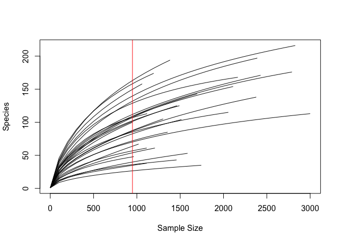

    # Rarefy at 949 seqs/sample
    set.seed(600) # Set a seed to make this reproducible, although you can also just write to disk and reload the file.
    input_filt_rar = single_rarefy(input_filt, 949) # This makes a new mctoolsR dataset called input_filt_rar

    ## 28 samples remaining

    # The number of samples remaining is stated. Any samples below the threshold get dropped.

    # Check seq counts in new dataset
    colSums(input_filt_rar$data_loaded) # Good - all 949! It worked.

    ## ProA12 ProA13 ProA14 ProA15 ProA16 ProA33 ProA34 ProA35 ProA36 ProA37 ProA65 ProA66 
    ##    949    949    949    949    949    949    949    949    949    949    949    949 
    ## ProB10 ProB12 ProB33 ProB34 ProB35 ProB36 ProB39 ProB40 ProB67 ProB70 ProB71  ProB9 
    ##    949    949    949    949    949    949    949    949    949    949    949    949 
    ## ProC36 ProC40 ProC65 ProC66 
    ##    949    949    949    949

    # Save the file. You can reload it with readRDS().
    saveRDS(input_filt_rar, file = "input_filt_rar.rds")
    input_filt_rar <- readRDS("input_filt_rar.rds")

# ALPHA DIVERSITY

## ASV richness and Shannon diversity. Let’s analyze and graph the number of OTUs (now ASVs) and the Shannon diversity across the sample types.

    # First let's get the number of ASVs (richness) per sample and add it to the mapping file
    input_filt_rar$map_loaded$rich <- specnumber(input_filt_rar$data_loaded, 
                                                 MARGIN = 2)

    # Now let's get the Shannon diversity index and add it to the mapping file
    # Note: Shannon diversity takes into account the ASV richness, as well as evenness
    input_filt_rar$map_loaded$shannon <- diversity(input_filt_rar$data_loaded, 
                                                   index = "shannon", 
                                                   MARGIN = 2)

    # Note: since the data_loaded file has ASVs as rows, MARGIN must be set to 2.

## Two categories: t-test (parametric) or Wilcoxon Test (non-parametric)

    # Two categories example
    leveneTest(input_filt_rar$map_loaded$rich ~ input_filt_rar$map_loaded$Farm_type)

    ## Warning in leveneTest.default(y = y, group = group, ...): group coerced to factor.

    ## Levene's Test for Homogeneity of Variance (center = median)
    ##       Df F value Pr(>F)
    ## group  1  0.0522 0.8211
    ##       26

    # Variance homogeneous (p > 0.05)

    shapiro.test(input_filt_rar$map_loaded$rich)

    ## 
    ##  Shapiro-Wilk normality test
    ## 
    ## data:  input_filt_rar$map_loaded$rich
    ## W = 0.97153, p-value = 0.6221

    # Richness normally distributed (p > 0.05)

    t.test(input_filt_rar$map_loaded$rich ~ input_filt_rar$map_loaded$Farm_type)

    ## 
    ##  Welch Two Sample t-test
    ## 
    ## data:  input_filt_rar$map_loaded$rich by input_filt_rar$map_loaded$Farm_type
    ## t = 1.2678, df = 18.164, p-value = 0.2209
    ## alternative hypothesis: true difference in means between group Conventional and group Organic is not equal to 0
    ## 95 percent confidence interval:
    ##  -12.72671  51.52671
    ## sample estimates:
    ## mean in group Conventional      mean in group Organic 
    ##                       98.5                       79.1

    # No significant difference in richness among the two categories

    # If Levene's Test or Shapiro-Wilk Test p < 0.05, use Wilcoxon Test
    wilcox.test(input_filt_rar$map_loaded$rich ~ input_filt_rar$map_loaded$Farm_type)

    ## 
    ##  Wilcoxon rank sum exact test
    ## 
    ## data:  input_filt_rar$map_loaded$rich by input_filt_rar$map_loaded$Farm_type
    ## W = 117, p-value = 0.2079
    ## alternative hypothesis: true location shift is not equal to 0

    # Same result

    # Box and whisker plot with points
    ggplot(input_filt_rar$map_loaded, aes(Farm_type, rich, colour = Farm_type)) +
      geom_boxplot(outlier.shape = NA) +
      geom_point(size = 3, alpha = 0.5) +
      labs(x = "Farm Type", y = "ASV Richness", colour = "Farm Type") +
      theme_bw() +
      theme(axis.title = element_text(face = "bold", size = 16), 
            axis.text = element_text(size = 14))

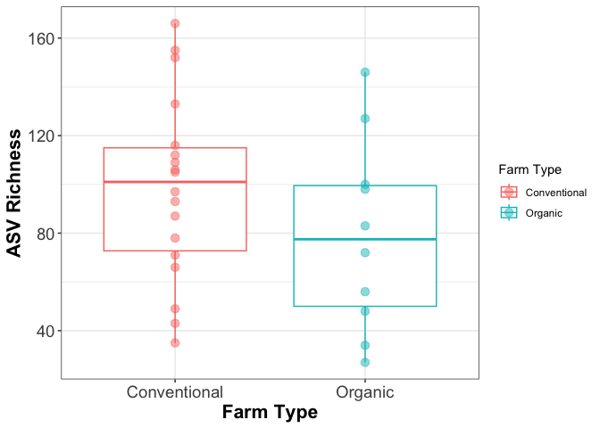

    # Box and whisker plot with jittered points (geom_jitter instead of geom_point)
    ggplot(input_filt_rar$map_loaded, aes(Farm_type, rich, colour = Farm_type)) +
      geom_boxplot(outlier.shape = NA) +
      geom_jitter(size = 3, alpha = 0.5, width = 0.25, height = 0) +
      labs(x = "Farm Type", y = "ASV Richness", colour = "Farm Type") +
      theme_bw() +
      theme(axis.title = element_text(face = "bold", size = 16), 
            axis.text = element_text(size = 14))

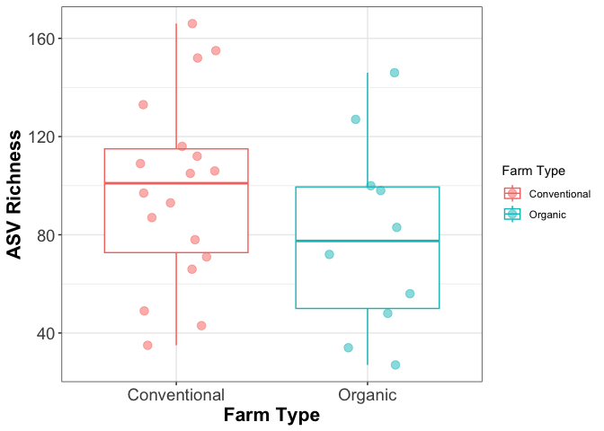

    # Don't need legend because each category is already clearly labeled
    ggplot(input_filt_rar$map_loaded, aes(Farm_type, rich, colour = Farm_type)) +
      geom_boxplot(outlier.shape = NA) +
      geom_jitter(size = 3, alpha = 0.5, width = 0.25, height = 0) +
      labs(x = "Farm Type", y = "ASV Richness", colour = "Farm Type") +
      theme_bw() +
      theme(axis.title = element_text(face = "bold", size = 16), 
            axis.text = element_text(size = 14),
            legend.position = "none")

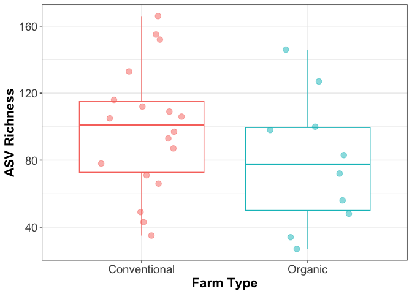

    # Change colors to be colorblind friendly (e.g., red and blue is better than red and green)
    ggplot(input_filt_rar$map_loaded, aes(Farm_type, rich, colour = Farm_type)) +
      geom_boxplot(outlier.shape = NA) +
      geom_jitter(size = 3, alpha = 0.5, width = 0.25, height = 0) +
      labs(x = "Farm Type", y = "ASV Richness", colour = "Farm Type") +
      scale_colour_manual(values = c("red", "blue")) +
      theme_bw() +
      theme(axis.title = element_text(face = "bold", size = 16), 
            axis.text = element_text(size = 14),
            legend.position = "none")

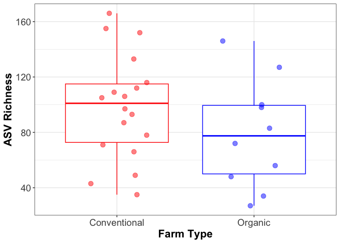

    # Save plot. This specifies a size and makes it reproducible. pdf default dimensions are in inches. could also use png or jpeg or ggsave. The file will go into working directory unless you specify a different path.
    p <- ggplot(input_filt_rar$map_loaded, aes(Farm_type, rich, colour = Farm_type)) +
      geom_boxplot(outlier.shape = NA) +
      geom_jitter(size = 3, alpha = 0.5, width = 0.25, height = 0) +
      labs(x = "Farm Type", y = "ASV Richness", colour = "Farm Type") +
      scale_colour_manual(values = c("red", "blue")) +
      theme_bw() +
      theme(axis.title = element_text(face = "bold", size = 16), 
            axis.text = element_text(size = 14),
            legend.position = "none")
    ggsave("FarmType.pdf", plot = p, width = 4, height = 4)

    # Now let's plot Shannon diversity. I cut and pasted the above plot and changed the y input and axis label
    ggplot(input_filt_rar$map_loaded, aes(Farm_type, shannon, colour = Farm_type)) +
      geom_boxplot(outlier.shape = NA) +
      geom_jitter(size = 3, alpha = 0.5, width = 0.25, height = 0) +
      labs(x = "Farm Type", y = "Shannon diversity", colour = "Farm Type") +
      scale_colour_manual(values = c("red", "blue")) +
      theme_bw() +
      theme(axis.title = element_text(face = "bold", size = 16), 
            axis.text = element_text(size = 14),
            legend.position = "none")

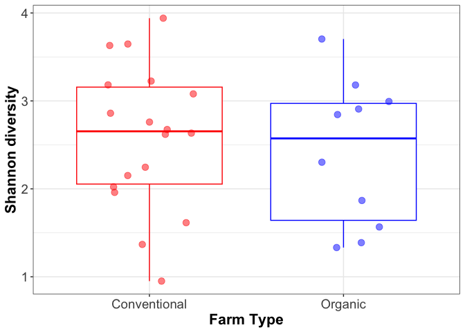

## Three + categores: ANOVA (parametric) or Kruskal-Wallis (non-parametric)

    # Three category example
    leveneTest(input_filt_rar$map_loaded$rich ~ input_filt_rar$map_loaded$Sample_type)

    ## Warning in leveneTest.default(y = y, group = group, ...): group coerced to factor.

    ## Levene's Test for Homogeneity of Variance (center = median)
    ##       Df F value Pr(>F)
    ## group  2  2.3697 0.1142
    ##       25

    # Variance homogeneous (p > 0.05)

    m <- aov(input_filt_rar$map_loaded$rich ~ input_filt_rar$map_loaded$Sample_type)
    shapiro.test(m$residuals)

    ## 
    ##  Shapiro-Wilk normality test
    ## 
    ## data:  m$residuals
    ## W = 0.95207, p-value = 0.2232

    # Residuals normally distributed (p > 0.05)
    # Note: Here we test the assumption that the residuals (not the data itself) are normally distributed

    # Other diagnostics - learn more here (https://data.library.virginia.edu/diagnostic-plots/)
    # Note: R markdown will plot all 4 diagnostic plots. If not in R markdown, click in the console and hit Return to see each diagnostic plot.
    plot(m) 

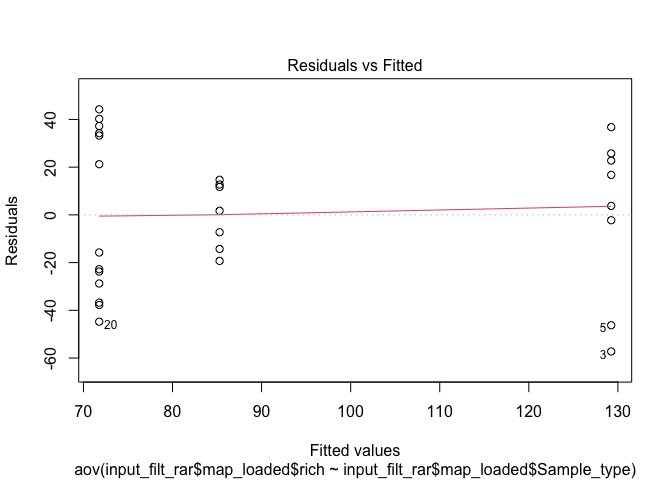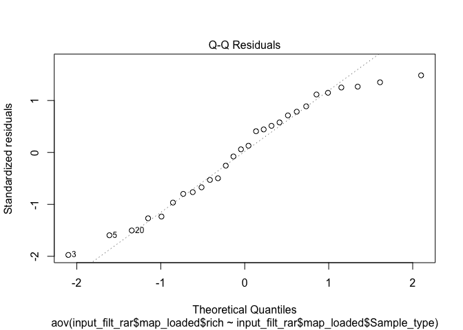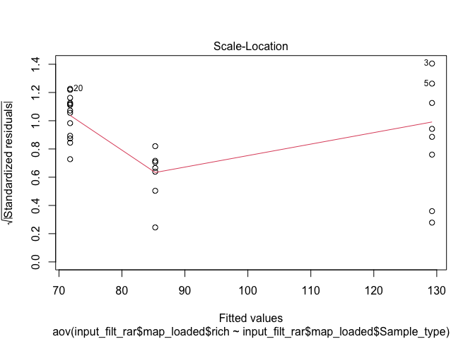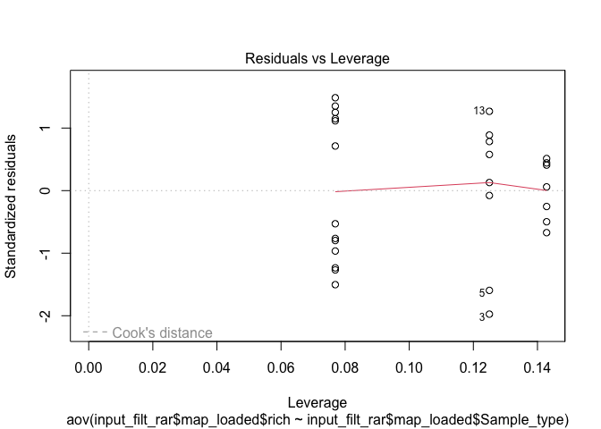

    # Check the model results.
    summary(m)

    ##                                       Df Sum Sq Mean Sq F value  Pr(>F)   
    ## input_filt_rar$map_loaded$Sample_type  2  16732    8366   8.705 0.00135 **
    ## Residuals                             25  24025     961                   
    ## ---
    ## Signif. codes:  0 '***' 0.001 '**' 0.01 '*' 0.05 '.' 0.1 ' ' 1

    # Significant effect. Run posthoc test to see which groups are different from each other.
    # Mushrooms different from spinach and strawberries. No diff between spinach and strawberries
    TukeyHSD(m)

    ##   Tukey multiple comparisons of means
    ##     95% family-wise confidence level
    ## 
    ## Fit: aov(formula = input_filt_rar$map_loaded$rich ~ input_filt_rar$map_loaded$Sample_type)
    ## 
    ## $`input_filt_rar$map_loaded$Sample_type`
    ##                             diff       lwr       upr     p adj
    ## Spinach-Mushrooms      -43.96429 -83.92742  -4.00115 0.0290426
    ## Strawberries-Mushrooms -57.48077 -92.17849 -22.78305 0.0010087
    ## Strawberries-Spinach   -13.51648 -49.71596  22.68299 0.6267806

    # If Levene's Test or Shapiro-Wilk Test p < 0.05, use Krukal-Wallis Test
    # Note: The Nemenyi test only accepts a factor independent variable so we add as.factor() to the independent variable.
    kruskal.test(input_filt_rar$map_loaded$rich ~ input_filt_rar$map_loaded$Sample_type)

    ## 
    ##  Kruskal-Wallis rank sum test
    ## 
    ## data:  input_filt_rar$map_loaded$rich by input_filt_rar$map_loaded$Sample_type
    ## Kruskal-Wallis chi-squared = 9.2183, df = 2, p-value = 0.00996

    # Significant effect. (agrees with ANOVA). Run posthoc.
    kwAllPairsNemenyiTest(input_filt_rar$map_loaded$rich ~ as.factor(input_filt_rar$map_loaded$Sample_type))

    ## 
    ##  Pairwise comparisons using Tukey-Kramer-Nemenyi all-pairs test with Tukey-Dist approximation

    ## data: input_filt_rar$map_loaded$rich by as.factor(input_filt_rar$map_loaded$Sample_type)

    ##              Mushrooms Spinach
    ## Spinach      0.0797    -      
    ## Strawberries 0.0086    0.8879

    ## 
    ## P value adjustment method: single-step

    ## alternative hypothesis: two.sided

    # Similar result, but spinach/mushroom different now only marginal. 
    # Use ANOVA result if assumptions passed because there is more power and data aren't rank transformed, which is a loss of information.

    # Plot. Just copy the previous plot, change the variable name and the colour argument! 
    # Here we'll try the viridis palette.
    ggplot(input_filt_rar$map_loaded, aes(Sample_type, rich, colour = Sample_type)) +
      geom_boxplot(outlier.shape = NA) +
      geom_jitter(size = 3, alpha = 0.5, width = 0.25, height = 0) +
      labs(x = "Sample Type", y = "ASV Richness", colour = "Farm Type") +
      scale_colour_viridis_d() +
      theme_bw() +
      theme(axis.title = element_text(face = "bold", size = 16), 
            axis.text = element_text(size = 14),
            legend.position = "none")

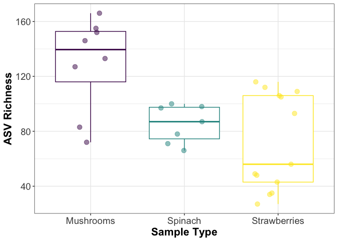

    # Now, since there was a significant difference, let's add some letter text. We'll make a new dataframe containing coordinates for the letters. Groups with different letters are significantly different. So it should be a b b. We set y to 180 to be above the maximum ASV richness.
    label_df <- data.frame(x = c("Mushrooms", "Spinach", "Strawberries"),
                           y = c(180, 180, 180),
                           label = c("a", "b", "b"))

    # Plot with added geom_text 
    ggplot(input_filt_rar$map_loaded, aes(Sample_type, rich, colour = Sample_type)) +
      geom_boxplot(outlier.shape = NA) +
      geom_jitter(size = 3, alpha = 0.5, width = 0.25, height = 0) +
      geom_text(data = label_df, aes(x, y, label = label), size = 5, inherit.aes = F) +
      labs(x = "Sample Type", y = "ASV Richness", colour = "Farm Type") +
      scale_colour_viridis_d() +
      theme_bw() +
      theme(axis.title = element_text(face = "bold", size = 16), 
            axis.text = element_text(size = 14),
            legend.position = "none")

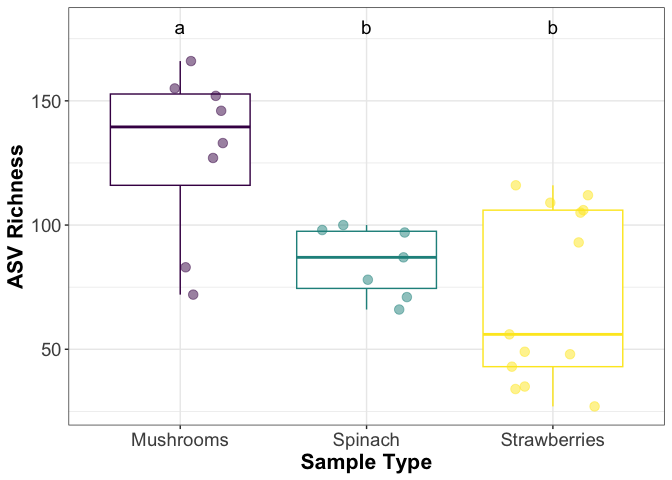

# Multipanel plot.

## What one might want to show as, say, Figure 1 in a paper for a nice overview of the microbial communities, could be a multipanel plot with both ASV richness and Shannon diversity.

# Let’s use an automated method for generating the significant difference letters, and then “melt” the data into long format for multipanel plotting

    ## Stats for rich and Shannon using ANOVA and emmeans and cld.
    m1 <- aov(rich ~ Sample_type, data = input_filt_rar$map_loaded)
    t1 <- emmeans(object = m1, specs = "Sample_type") %>%
      cld(object = ., adjust = "Tukey", Letters = letters, alpha = 0.05) %>%
      mutate(name = "rich",
             y = 180)

    ## Note: adjust = "tukey" was changed to "sidak"
    ## because "tukey" is only appropriate for one set of pairwise comparisons

    m2 <- aov(shannon ~ Sample_type, data = input_filt_rar$map_loaded)
    t2 <- emmeans(object = m2, specs = "Sample_type") %>%
      cld(object = ., adjust = "Tukey", Letters = letters, alpha = 0.05) %>%
      mutate(name = "shannon",
             y = 5)

    ## Note: adjust = "tukey" was changed to "sidak"
    ## because "tukey" is only appropriate for one set of pairwise comparisons

    # Note: The sidak note is fine. It's still a Tukey posthoc test, just with sidak adjustment.

    # Combine the labels
    label_df <- rbind(t1, t2)

    # Set names for the facet strips
    facet_df <- c("rich" = "(a) Richness",
                  "shannon" = "(b) Shannon")

    # Make the data long format
    alpha_long <- input_filt_rar$map_loaded %>%
      pivot_longer(cols = c("rich", "shannon"))
    # This will put the richness and Shannon values into a column named "value"
    # It will make a new column ("name") which maps the values to either richness or shannon

    # Plot using facet_wrap to make the two panels. We use scales = "free_y" to let the y-axis scale vary among the two panels.
    ggplot(alpha_long, aes(Sample_type, value, colour = Sample_type)) +
      geom_boxplot(outlier.shape = NA) +
      geom_jitter(size = 3, alpha = 0.5, width = 0.25, height = 0) +
      geom_text(data = label_df, 
                aes(Sample_type, y, label = str_trim(.group)), 
                size = 5, inherit.aes = F) +
      labs(x = "Sample Type", y = "ASV Richness", colour = "Farm Type") +
      scale_colour_viridis_d() +
      facet_wrap(~name, ncol = 2, scales = "free_y", labeller = as_labeller(facet_df)) +
      theme_bw() +
      theme(axis.title = element_text(face = "bold", size = 16), 
            axis.text = element_text(size = 14),
            strip.text = element_text(size = 18),
            legend.position = "none")

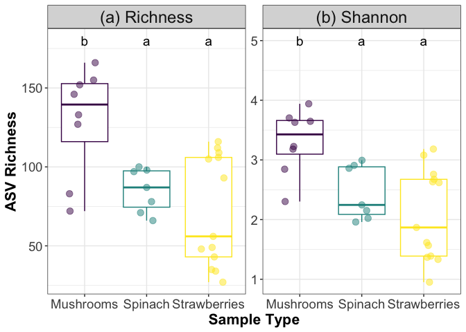

# BETA DIVERSITY

### Now let’s assess differences in entire community composition among sample types. We will calculate Aitchison and Bray-Curtis dissimilarity, plot ordinations, and run multivariate stats. The conventional method has long been to calculate a Bray-Curtis dissimilarity matrix and then plot a PCoA or NMDS. We will first do these and then go over a newer method that is now preferred by many (e.g., Gloor et al. 2017 Frontiers in Microbiology <https://doi.org/10.3389/fmicb.2017.02224>).

## Bray-Curtis and NMDS

    # Calculate dissimilarity matrix
    dm <- calc_dm(input_filt_rar$data_loaded)
    # NOTE: calc_dm uses Bray-Curtis after square root transformation ("bray_sq_trans") by default. Can change to others using method=type_of_function in the script

    # Let's calculate an ordination from the distance matrix
    ord <- calc_ordination(dm, 'nmds')

    ## Run 0 stress 0.1045557 
    ## Run 1 stress 0.1227621 
    ## Run 2 stress 0.1050761 
    ## Run 3 stress 0.1045555 
    ## ... New best solution
    ## ... Procrustes: rmse 0.000163231  max resid 0.0006795881 
    ## ... Similar to previous best
    ## Run 4 stress 0.1199644 
    ## Run 5 stress 0.124056 
    ## Run 6 stress 0.1050761 
    ## Run 7 stress 0.1337521 
    ## Run 8 stress 0.1199642 
    ## Run 9 stress 0.1231582 
    ## Run 10 stress 0.1240559 
    ## Run 11 stress 0.1352062 
    ## Run 12 stress 0.1199643 
    ## Run 13 stress 0.1045556 
    ## ... Procrustes: rmse 0.0003409372  max resid 0.001420896 
    ## ... Similar to previous best
    ## Run 14 stress 0.1358001 
    ## Run 15 stress 0.1045555 
    ## ... Procrustes: rmse 0.0003152746  max resid 0.001313637 
    ## ... Similar to previous best
    ## Run 16 stress 0.1249811 
    ## Run 17 stress 0.1045555 
    ## ... Procrustes: rmse 0.0003039307  max resid 0.001265566 
    ## ... Similar to previous best
    ## Run 18 stress 0.1045556 
    ## ... Procrustes: rmse 0.0003394067  max resid 0.001413822 
    ## ... Similar to previous best
    ## Run 19 stress 0.1240559 
    ## Run 20 stress 0.1240559 
    ## *** Best solution repeated 5 times

    # NOTE: You can also run pcoa and others by changing the code above from NMDS

    # Now plot the ordination using the default mctoolsR function.
    plot_ordination(input_filt_rar, ord, 'Sample_type', 'Farm_type', hulls = TRUE)

    ## Warning: `do_()` was deprecated in dplyr 0.7.0.
    ## ℹ Please use `do()` instead.
    ## ℹ See vignette('programming') for more help
    ## ℹ The deprecated feature was likely used in the mctoolsr package.
    ##   Please report the issue at <https://github.com/leffj/mctoolsr/issues>.
    ## This warning is displayed once every 8 hours.
    ## Call `lifecycle::last_lifecycle_warnings()` to see where this warning was generated.

    ## Warning: `group_by_()` was deprecated in dplyr 0.7.0.
    ## ℹ Please use `group_by()` instead.
    ## ℹ See vignette('programming') for more help
    ## ℹ The deprecated feature was likely used in the mctoolsr package.
    ##   Please report the issue at <https://github.com/leffj/mctoolsr/issues>.
    ## This warning is displayed once every 8 hours.
    ## Call `lifecycle::last_lifecycle_warnings()` to see where this warning was generated.

    ## Warning: `aes_string()` was deprecated in ggplot2 3.0.0.
    ## ℹ Please use tidy evaluation idioms with `aes()`.
    ## ℹ See also `vignette("ggplot2-in-packages")` for more information.
    ## ℹ The deprecated feature was likely used in the mctoolsr package.
    ##   Please report the issue at <https://github.com/leffj/mctoolsr/issues>.
    ## This warning is displayed once every 8 hours.
    ## Call `lifecycle::last_lifecycle_warnings()` to see where this warning was generated.

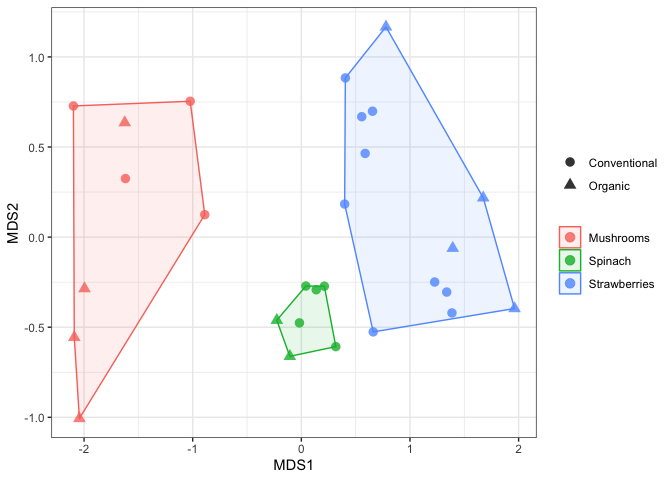

    #this is a nice thing to do at the start of an analysis to see what your data is doing

    # NOTE: plot_ordination is a good way to quickly plot data. However, if you want to do more complicated edits to a plot, you should save the ordination values from the calc_ordination() step as a dataframe and plot in ggplot as shown below.

## Bray-Curtis and PCoA

### This does basically the same thing as above, but it uses Principle Coordinates Analysis (PCoA) instead of Non-metric multidimensional scaling (NMDS). It is worth seeing that you can do basically the same thing using two different codes and is a good check of the consistency of the ordination. We also demonstrate saving the ordination scores and making a custom ggplot figure rather than relying on the default mctoolsR function.

    # Bray-Curtis dissimilarity matrix. Note: By default the data are square-root transformed.
    bc <- calc_dm(input_filt_rar$data_loaded)

    # Principle Coordinates Analysis (PCoA)
    pcoa <- cmdscale(bc, k = nrow(input_filt_rar$map_loaded) - 1, eig = T)

    # Variation Explained
    eigenvals(pcoa)/sum(eigenvals(pcoa)) # 23.3, 16.6 % variation explained

    ##  [1] 0.23299874 0.16603055 0.12452778 0.08016005 0.04836278 0.04258608 0.03804139
    ##  [8] 0.03274082 0.02968823 0.02785019 0.02095102 0.02045540 0.01652821 0.01518103
    ## [15] 0.01370175 0.01275645 0.01188354 0.01128799 0.00957814 0.00922398 0.00795294
    ## [22] 0.00732115 0.00670822 0.00555404 0.00428130 0.00314296 0.00050527 0.00000000

    # Make axis labels with % variation explained rounded to 1 digit.
    pcoaA1 <- paste("PC1: ", round((eigenvals(pcoa)/sum(eigenvals(pcoa)))[1]*100, 1), "%")
    pcoaA2 <- paste("PC2: ", round((eigenvals(pcoa)/sum(eigenvals(pcoa)))[2]*100, 1), "%") 

    # Save Axis 1 and 2 scores to the mapping file
    input_filt_rar$map_loaded$Axis01 <- scores(pcoa)[,1]
    input_filt_rar$map_loaded$Axis02 <- scores(pcoa)[,2]

    # Function for making a convex hull
    find_hull <- function(df) df[chull(df$Axis01, df$Axis02),]

    # Calculate hulls and save to dataframe
    micro.hulls <- ddply(input_filt_rar$map_loaded, c("Sample_type", "Farm_type"), find_hull)

    # Plot
    ggplot(input_filt_rar$map_loaded, aes(Axis01, Axis02, colour = Sample_type, shape = Farm_type)) +
      geom_polygon(data = micro.hulls, aes(colour = Sample_type, fill = Sample_type),
                   alpha = 0.1, show.legend = F) +
      geom_point(size = 2, alpha = 0.5) +
      labs(x = pcoaA1, 
           y = pcoaA2,
           colour = "Food",
           shape = "Farm") +
      scale_colour_viridis_d() +
      scale_fill_viridis_d() +
      theme_bw() +  
      theme(legend.position = "right",
            axis.title = element_text(face = "bold", size = 16), 
            axis.text = element_text(size = 14))

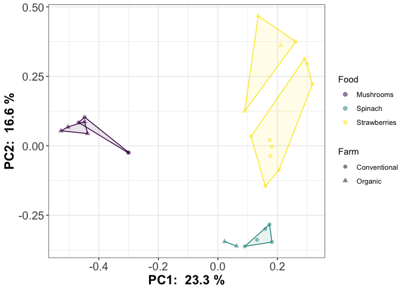

## Aitchison Matrix and PCA

### Some authors (e.g., Gloor et al. 2017) have argued for using Aitchison’s distance instead of Bray-Curtis dissimilarity. Then, a PCA instead of PCoA is performed. Instead of using rarefied data, we will use our unrarefied (but filtered) dataset and perform a center log ratio transformation.

    # First perform zero replacement and center log ratio (CLR) transformation. Use filtered but unrarefied data for this ("input_filt").
    otu_czm <- cmultRepl(t(input_filt$data_loaded), label = 0, method = "CZM")

    ## Warning in cmultRepl(t(input_filt$data_loaded), label = 0, method = "CZM"): Column no. 1 containing >80% zeros/unobserved values deleted (see arguments z.warning and z.delete).
    ## Column no. 2 containing >80% zeros/unobserved values deleted (see arguments z.warning and z.delete).
    ## Column no. 3 containing >80% zeros/unobserved values deleted (see arguments z.warning and z.delete).
    ## Column no. 4 containing >80% zeros/unobserved values deleted (see arguments z.warning and z.delete).
    ## Column no. 6 containing >80% zeros/unobserved values deleted (see arguments z.warning and z.delete).
    ## Column no. 7 containing >80% zeros/unobserved values deleted (see arguments z.warning and z.delete).
    ## Column no. 8 containing >80% zeros/unobserved values deleted (see arguments z.warning and z.delete).
    ## Column no. 10 containing >80% zeros/unobserved values deleted (see arguments z.warning and z.delete).
    ## Column no. 11 containing >80% zeros/unobserved values deleted (see arguments z.warning and z.delete).
    ## Column no. 12 containing >80% zeros/unobserved values deleted (see arguments z.warning and z.delete).
    ## Column no. 13 containing >80% zeros/unobserved values deleted (see arguments z.warning and z.delete).
    ## Column no. 14 containing >80% zeros/unobserved values deleted (see arguments z.warning and z.delete).
    ## Column no. 15 containing >80% zeros/unobserved values deleted (see arguments z.warning and z.delete).
    ## Column no. 16 containing >80% zeros/unobserved values deleted (see arguments z.warning and z.delete).
    ## Column no. 17 containing >80% zeros/unobserved values deleted (see arguments z.warning and z.delete).
    ## Column no. 18 containing >80% zeros/unobserved values deleted (see arguments z.warning and z.delete).
    ## Column no. 19 containing >80% zeros/unobserved values deleted (see arguments z.warning and z.delete).
    ## Column no. 20 containing >80% zeros/unobserved values deleted (see arguments z.warning and z.delete).
    ## Column no. 21 containing >80% zeros/unobserved values deleted (see arguments z.warning and z.delete).
    ## Column no. 22 containing >80% zeros/unobserved values deleted (see arguments z.warning and z.delete).
    ## Column no. 24 containing >80% zeros/unobserved values deleted (see arguments z.warning and z.delete).
    ## Column no. 25 containing >80% zeros/unobserved values deleted (see arguments z.warning and z.delete).
    ## Column no. 26 containing >80% zeros/unobserved values deleted (see arguments z.warning and z.delete).
    ## Column no. 28 containing >80% zeros/unobserved values deleted (see arguments z.warning and z.delete).
    ## Column no. 29 containing >80% zeros/unobserved values deleted (see arguments z.warning and z.delete).
    ## Column no. 30 containing >80% zeros/unobserved values deleted (see arguments z.warning and z.delete).
    ## Column no. 31 containing >80% zeros/unobserved values deleted (see arguments z.warning and z.delete).
    ## Column no. 32 containing >80% zeros/unobserved values deleted (see arguments z.warning and z.delete).
    ## Column no. 34 containing >80% zeros/unobserved values deleted (see arguments z.warning and z.delete).
    ## Column no. 35 containing >80% zeros/unobserved values deleted (see arguments z.warning and z.delete).
    ## Column no. 36 containing >80% zeros/unobserved values deleted (see arguments z.warning and z.delete).
    ## Column no. 37 containing >80% zeros/unobserved values deleted (see arguments z.warning and z.delete).
    ## Column no. 38 containing >80% zeros/unobserved values deleted (see arguments z.warning and z.delete).
    ## Column no. 39 containing >80% zeros/unobserved values deleted (see arguments z.warning and z.delete).
    ## Column no. 40 containing >80% zeros/unobserved values deleted (see arguments z.warning and z.delete).
    ## Column no. 41 containing >80% zeros/unobserved values deleted (see arguments z.warning and z.delete).
    ## Column no. 42 containing >80% zeros/unobserved values deleted (see arguments z.warning and z.delete).
    ## Column no. 43 containing >80% zeros/unobserved values deleted (see arguments z.warning and z.delete).
    ## Column no. 44 containing >80% zeros/unobserved values deleted (see arguments z.warning and z.delete).
    ## Column no. 45 containing >80% zeros/unobserved values deleted (see arguments z.warning and z.delete).
    ## Column no. 47 containing >80% zeros/unobserved values deleted (see arguments z.warning and z.delete).
    ## Column no. 48 containing >80% zeros/unobserved values deleted (see arguments z.warning and z.delete).
    ## Column no. 49 containing >80% zeros/unobserved values deleted (see arguments z.warning and z.delete).
    ## Column no. 51 containing >80% zeros/unobserved values deleted (see arguments z.warning and z.delete).
    ## Column no. 52 containing >80% zeros/unobserved values deleted (see arguments z.warning and z.delete).
    ## Column no. 53 containing >80% zeros/unobserved values deleted (see arguments z.warning and z.delete).
    ## Column no. 55 containing >80% zeros/unobserved values deleted (see arguments z.warning and z.delete).
    ## Column no. 56 containing >80% zeros/unobserved values deleted (see arguments z.warning and z.delete).
    ## Column no. 57 containing >80% zeros/unobserved values deleted (see arguments z.warning and z.delete).
    ## Column no. 59 containing >80% zeros/unobserved values deleted (see arguments z.warning and z.delete).
    ## Column no. 61 containing >80% zeros/unobserved values deleted (see arguments z.warning and z.delete).
    ## Column no. 62 containing >80% zeros/unobserved values deleted (see arguments z.warning and z.delete).
    ## Column no. 63 containing >80% zeros/unobserved values deleted (see arguments z.warning and z.delete).
    ## Column no. 64 containing >80% zeros/unobserved values deleted (see arguments z.warning and z.delete).
    ## Column no. 66 containing >80% zeros/unobserved values deleted (see arguments z.warning and z.delete).
    ## Column no. 67 containing >80% zeros/unobserved values deleted (see arguments z.warning and z.delete).
    ## Column no. 68 containing >80% zeros/unobserved values deleted (see arguments z.warning and z.delete).
    ## Column no. 69 containing >80% zeros/unobserved values deleted (see arguments z.warning and z.delete).
    ## Column no. 70 containing >80% zeros/unobserved values deleted (see arguments z.warning and z.delete).
    ## Column no. 71 containing >80% zeros/unobserved values deleted (see arguments z.warning and z.delete).
    ## Column no. 72 containing >80% zeros/unobserved values deleted (see arguments z.warning and z.delete).
    ## Column no. 73 containing >80% zeros/unobserved values deleted (see arguments z.warning and z.delete).
    ## Column no. 74 containing >80% zeros/unobserved values deleted (see arguments z.warning and z.delete).
    ## Column no. 76 containing >80% zeros/unobserved values deleted (see arguments z.warning and z.delete).
    ## Column no. 78 containing >80% zeros/unobserved values deleted (see arguments z.warning and z.delete).
    ## Column no. 79 containing >80% zeros/unobserved values deleted (see arguments z.warning and z.delete).
    ## Column no. 80 containing >80% zeros/unobserved values deleted (see arguments z.warning and z.delete).
    ## Column no. 81 containing >80% zeros/unobserved values deleted (see arguments z.warning and z.delete).
    ## Column no. 82 containing >80% zeros/unobserved values deleted (see arguments z.warning and z.delete).
    ## Column no. 83 containing >80% zeros/unobserved values deleted (see arguments z.warning and z.delete).
    ## Column no. 84 containing >80% zeros/unobserved values deleted (see arguments z.warning and z.delete).
    ## Column no. 85 containing >80% zeros/unobserved values deleted (see arguments z.warning and z.delete).
    ## Column no. 86 containing >80% zeros/unobserved values deleted (see arguments z.warning and z.delete).
    ## Column no. 88 containing >80% zeros/unobserved values deleted (see arguments z.warning and z.delete).
    ## Column no. 89 containing >80% zeros/unobserved values deleted (see arguments z.warning and z.delete).
    ## Column no. 90 containing >80% zeros/unobserved values deleted (see arguments z.warning and z.delete).
    ## Column no. 91 containing >80% zeros/unobserved values deleted (see arguments z.warning and z.delete).
    ## Column no. 92 containing >80% zeros/unobserved values deleted (see arguments z.warning and z.delete).
    ## Column no. 93 containing >80% zeros/unobserved values deleted (see arguments z.warning and z.delete).
    ## Column no. 94 containing >80% zeros/unobserved values deleted (see arguments z.warning and z.delete).
    ## Column no. 95 containing >80% zeros/u

    ## Warning in cmultRepl(t(input_filt$data_loaded), label = 0, method = "CZM"): Row no. 3 containing >80% zeros/unobserved values deleted (see arguments z.warning and z.delete).
    ## Row no. 17 containing >80% zeros/unobserved values deleted (see arguments z.warning and z.delete).
    ## Row no. 19 containing >80% zeros/unobserved values deleted (see arguments z.warning and z.delete).
    ## Row no. 20 containing >80% zeros/unobserved values deleted (see arguments z.warning and z.delete).
    ## Row no. 26 containing >80% zeros/unobserved values deleted (see arguments z.warning and z.delete).

    ## No. adjusted imputations:  84

    otu_clr <- clr(otu_czm)
    aclr <- compositions::dist(otu_clr)

    # Filter dropped samples
    # Columns and rows containing more than 80% zeros/unobserved values were deleted
    # This is the bad thing about this method. We have now lost some samples and ASVs.
    # You can also avoid this by adjusting the z.warning.
    # Here we just proceed with the default.
    dim(t(input_filt$data_loaded)) # 28 samples, 933 ASVs

    ## [1]  28 933

    dim(otu_czm) # 23 samples, 144 ASVs

    ## [1]  23 144

    # Make a sampleID column
    input_filt$map_loaded$sampleID <- rownames(input_filt$map_loaded)

    # Filter out sampleIDs not in the CLR dataset. Save as new mctoolsR object.
    input_filt_clr <- filter_data(input_filt,
                                  filter_cat = "sampleID",
                                  keep_vals = rownames(otu_czm))

    ## 23 samples remaining

    # PCA (principle components analysis)
    d.pcx <- prcomp(aclr)

    # % variation explained
    d.mvar <- sum(d.pcx$sdev^2)

    # Make axes labels with % variation explained
    PC1 <- paste("PC1: ", round((sum(d.pcx$sdev[1]^2)/d.mvar)*100, 1), "%")
    PC2 <- paste("PC2: ", round((sum(d.pcx$sdev[2]^2)/d.mvar)*100, 1), "%")

    # Save scores to map_loaded dataframe
    input_filt_clr$map_loaded$Axis01 <- d.pcx$x[,1]
    input_filt_clr$map_loaded$Axis02 <- d.pcx$x[,2]

    # Transform the scores
    input_filt_clr$map_loaded$Axis01 <- input_filt_clr$map_loaded$Axis01/sqrt(sum((input_filt_clr$map_loaded$Axis01 - mean(input_filt_clr$map_loaded$Axis01))^2))
    input_filt_clr$map_loaded$Axis02 <- input_filt_clr$map_loaded$Axis02/sqrt(sum((input_filt_clr$map_loaded$Axis02 - mean(input_filt_clr$map_loaded$Axis02))^2))

    # Calculate hulls
    micro.hulls <- ddply(input_filt_clr$map_loaded, c("Sample_type", "Farm_type"), find_hull)

    # Plot
    ggplot(input_filt_clr$map_loaded, aes(Axis01, Axis02, colour = Sample_type, shape = Farm_type)) +
      geom_polygon(data = micro.hulls, aes(colour = Sample_type, fill = Sample_type),
                   alpha = 0.1, show.legend = F) +
      geom_point(size = 2, alpha = 0.5) +
      labs(x = PC1, 
           y = PC1,
           colour = "Food",
           shape = "Farm") +
      scale_colour_viridis_d() +
      scale_fill_viridis_d() +
      theme_bw() +  
      theme(legend.position = "right",
            axis.title = element_text(face = "bold", size = 16), 
            axis.text = element_text(size = 14))

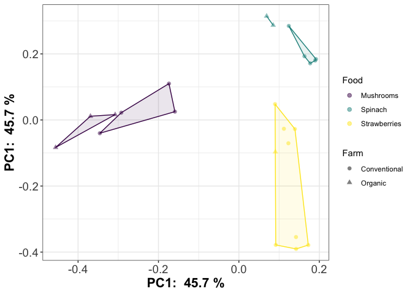

    # Note: This is very consistent with the Bray-Curtis and PCoA.

## PERMANOVA, PERMDISP

### Now we need to run some statisitcs to test for differences in community composition among treatments as well as homogeneity of dispersion within treatments.

    # PERMANOVA (multivariate version of ANOVA)
    set.seed(1223) # To make reproducible 
    m <- adonis2(bc ~ input_filt_rar$map_loaded$Sample_type*input_filt_rar$map_loaded$Farm_type)
    m

    ## Permutation test for adonis under reduced model
    ## Permutation: free
    ## Number of permutations: 999
    ## 
    ## adonis2(formula = bc ~ input_filt_rar$map_loaded$Sample_type * input_filt_rar$map_loaded$Farm_type)
    ##          Df SumOfSqs      R2      F Pr(>F)    
    ## Model     5   4.7942 0.50039 4.4069  0.001 ***
    ## Residual 22   4.7867 0.49961                  
    ## Total    27   9.5809 1.00000                  
    ## ---
    ## Signif. codes:  0 '***' 0.001 '**' 0.01 '*' 0.05 '.' 0.1 ' ' 1

    # Significant effects of sample type, farm type and interaction.

    # What about pairwise PERMANOVA? This is similar to a Tukey posthoc an an ANOVA.
    # Grouping variable must be a factor
    input_filt_rar$map_loaded$Sample_type <- as.factor(input_filt_rar$map_loaded$Sample_type)
    # Don't run until mctoolsr updates from adonis to adonis2
    #set.seed(1223)
    #m_pw <- calc_pairwise_permanovas(bc, input_filt_rar$map_loaded, "Sample_type")
    #m_pw # Each group is significantly different from the other.

    # PERMDISP (multivariate version of Levene's Test)
    m1 <- betadisper(bc, input_filt_rar$map_loaded$Sample_type)
    anova(m1) # Dispersion different

    ## Analysis of Variance Table
    ## 
    ## Response: Distances
    ##           Df   Sum Sq  Mean Sq F value    Pr(>F)    
    ## Groups     2 0.146182 0.073091   20.36 5.663e-06 ***
    ## Residuals 25 0.089748 0.003590                      
    ## ---
    ## Signif. codes:  0 '***' 0.001 '**' 0.01 '*' 0.05 '.' 0.1 ' ' 1

    m2 <- betadisper(bc, input_filt_rar$map_loaded$Farm_type)
    anova(m2) # Dispersion homogeneous

    ## Analysis of Variance Table
    ## 
    ## Response: Distances
    ##           Df  Sum Sq   Mean Sq F value Pr(>F)
    ## Groups     1 0.01824 0.0182398   2.586 0.1199
    ## Residuals 26 0.18339 0.0070533

    m3 <- betadisper(bc, input_filt_rar$map_loaded$Sample_Farming)
    anova(m3) # Dispersion different

    ## Analysis of Variance Table
    ## 
    ## Response: Distances
    ##           Df  Sum Sq  Mean Sq F value   Pr(>F)   
    ## Groups     5 0.20207 0.040414  4.2705 0.007261 **
    ## Residuals 22 0.20820 0.009464                    
    ## ---
    ## Signif. codes:  0 '***' 0.001 '**' 0.01 '*' 0.05 '.' 0.1 ' ' 1

    # Let's add the centroids to our PCoA plot.
    # Centroids are contained here:
    m3$centroids

    ##                                 PCoA1       PCoA2       PCoA3        PCoA4
    ## Mushrooms_Conventional    -0.38575907  0.03883206 -0.01061624 -0.262371754
    ## Mushrooms_Organic         -0.48736641  0.06046629  0.04946520  0.269786066
    ## Spinach_Conventional       0.14842443 -0.32777104  0.11029008  0.035217506
    ## Spinach_Organic            0.04248558 -0.35249459  0.16583474 -0.049806583
    ## Strawberries_Conventional  0.21382989  0.06724047 -0.11846836  0.005091353
    ## Strawberries_Organic       0.18535239  0.35687881  0.03360756  0.017843245
    ##                                  PCoA5        PCoA6       PCoA7        PCoA8
    ## Mushrooms_Conventional     0.007037599  0.010727625  0.01413591  0.024114352
    ## Mushrooms_Organic          0.045091973 -0.008263157  0.01704842 -0.018779567
    ## Spinach_Conventional       0.036795703  0.044499909 -0.10744589  0.057006371
    ## Spinach_Organic           -0.193589544 -0.136837666  0.09354917  0.009955471
    ## Strawberries_Conventional  0.067823499  0.022776835  0.06926734 -0.032714414
    ## Strawberries_Organic      -0.134110306 -0.046712483 -0.12714419 -0.016102192
    ##                                  PCoA9      PCoA10      PCoA11       PCoA12
    ## Mushrooms_Conventional    -0.006914227  0.11702031 -0.02698791 -0.006258975
    ## Mushrooms_Organic         -0.007050640 -0.05766898  0.02147945 -0.003249889
    ## Spinach_Conventional      -0.021404063  0.02237317  0.01008622 -0.029165971
    ## Spinach_Organic            0.044903875 -0.07110968 -0.03133753  0.042587096
    ## Strawberries_Conventional -0.034957121 -0.01011234 -0.01527359  0.016338512
    ## Strawberries_Organic       0.040758276  0.02419418  0.03612080 -0.024481711
    ##                                 PCoA13       PCoA14        PCoA15       PCoA16
    ## Mushrooms_Conventional    -0.003960223 -0.006730886  0.0009626401  0.005563734
    ## Mushrooms_Organic          0.008540610 -0.005277012  0.0031150796 -0.005888112
    ## Spinach_Conventional       0.003465431 -0.036029157  0.0027143436  0.011429085
    ## Spinach_Organic           -0.026612229  0.091813095 -0.0083078665 -0.045376336
    ## Strawberries_Conventional -0.011999039  0.008081568 -0.0032411634 -0.000675784
    ## Strawberries_Organic       0.018272143  0.009819088  0.0021547380 -0.008962818
    ##                                 PCoA17       PCoA18        PCoA19       PCoA20
    ## Mushrooms_Conventional     0.005720225  0.010544143 -2.115491e-05 -0.005627660
    ## Mushrooms_Organic          0.005028245 -0.008982367  6.953284e-03  0.010701290
    ## Spinach_Conventional      -0.007022220  0.015678956  6.312013e-03  0.013330204
    ## Spinach_Organic            0.034767559 -0.033496916 -2.966745e-02 -0.003740187
    ## Strawberries_Conventional -0.004949216 -0.008183587  4.035726e-03 -0.009357069
    ## Strawberries_Organic       0.012706439  0.009206557 -1.034710e-02  0.015367916
    ##                                  PCoA21       PCoA22        PCoA23       PCoA24
    ## Mushrooms_Conventional     0.0056129083  0.009042009  0.0009245449 -0.006018883
    ## Mushrooms_Organic         -0.0072696618  0.008235559  0.0006905917 -0.004527507
    ## Spinach_Conventional      -0.0097473366 -0.002722524  0.0052384694  0.019420532
    ## Spinach_Organic            0.0176757805  0.007474991 -0.0497621993 -0.021066493
    ## Strawberries_Conventional -0.0007101365  0.005141392 -0.0018611850 -0.001863626
    ## Strawberries_Organic      -0.0027793625 -0.011338879  0.0074435442 -0.006957195
    ##                                  PCoA25       PCoA26        PCoA27
    ## Mushrooms_Conventional    -0.0004846792  0.001620327  0.0002772015
    ## Mushrooms_Organic          0.0024893278 -0.001371614 -0.0001481248
    ## Spinach_Conventional       0.0012518818 -0.003043980  0.0003390877
    ## Spinach_Organic           -0.0028499057 -0.010268601 -0.0029428609
    ## Strawberries_Conventional -0.0037592705  0.001903678  0.0030039133
    ## Strawberries_Organic       0.0117045356 -0.002096310 -0.0060292168

    # First make a clean data frame with %>%
    centroids <- as.data.frame(m3$centroids) %>%
      dplyr::select(PCoA1, PCoA2) %>%
      rename(Axis01 = PCoA1,
             Axis02 = PCoA2) %>%
      rownames_to_column(var = "Sample_Farming") %>%
      separate(Sample_Farming, into = c("Sample_type", "Farm_type"), sep = "_")

    # Remake the hulls
    micro.hulls <- ddply(input_filt_rar$map_loaded, c("Sample_type", "Farm_type"), find_hull)

    # Plot
    ggplot(input_filt_rar$map_loaded, aes(Axis01, Axis02, colour = Sample_type, shape = Farm_type)) +
      geom_polygon(data = micro.hulls, aes(colour = Sample_type, fill = Sample_type),
                   alpha = 0.1, show.legend = F) +
      geom_point(size = 2, alpha = 0.5) +
      geom_point(data = centroids, size = 4) +
      labs(x = pcoaA1, 
           y = pcoaA2,
           colour = "Food",
           shape = "Farm") +
      scale_colour_viridis_d() +
      scale_fill_viridis_d() +
      theme_bw() +  
      theme(legend.position = "right",
            axis.title = element_text(face = "bold", size = 16), 
            axis.text = element_text(size = 14))

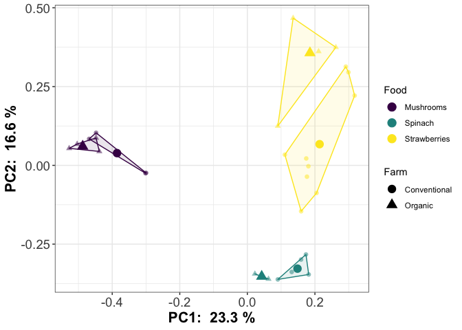

## Multipanel PCoA plots

### As a bonus, let’s make a multipanel PCoA plot. This can be really useful if you have a 16S dataset and an 18S or ITS dataset, and you want to show both side by side. In this case, let’s just make another PCoA with the same dataset. Let’s just use the original unfiltered unrarefied dataset. This will also show us how filtering and rarefying affected the analysis. Let’s remove lettuce though so the factor levels are the same.

    # Bray-Curtis Matrix
    input_nolet <- filter_data(input,
                               filter_cat = "Sample_type",
                               filter_vals = "Lettuce") # 28 samples remaining (removed 4)

    ## 28 samples remaining

    bc2 <- calc_dm(input_nolet$data_loaded)

    # Principle Coordinates Analysis (PCoA)
    pcoa2 <- cmdscale(bc2, k = nrow(input_nolet$map_loaded) - 1, eig = T)

    # Variation Explained
    eigenvals(pcoa2)/sum(eigenvals(pcoa2)) # 18.0, 13.9 % variation explained

    ##  [1] 0.18038793 0.13909543 0.10727935 0.06995555 0.04782424 0.04251012 0.04037428
    ##  [8] 0.03387551 0.03344651 0.03081348 0.02753299 0.02585268 0.02451780 0.02207721
    ## [15] 0.02006282 0.01860184 0.01722138 0.01578966 0.01516671 0.01493567 0.01433535
    ## [22] 0.01329144 0.01264790 0.01010843 0.00947210 0.00716815 0.00565548 0.00000000

    # Save Axis 1 and 2 to the mapping file
    input_nolet$map_loaded$Axis01 <- scores(pcoa2)[,1]
    input_nolet$map_loaded$Axis02 <- scores(pcoa2)[,2]

    # Now we need to combine the two datasets. We'll stack them on top of each other with rbind. In order to do this, the columns must match. Right now we have an extra columns in input_filt_rar$map_loaded (e.g., rich and shannon). To be sure let's just select the columns we need from each and then stack. We also need to add a column stating the dataset - we'll use this as a variable to specify the panels.
    df1 <- input_filt_rar$map_loaded %>%
      dplyr::select(Sample_type, Farm_type, Sample_Farming, Axis01, Axis02) %>%
      mutate(Dataset = "a) Rarefied, filtered")
    df2 <- input_nolet$map_loaded %>%
      dplyr::select(Sample_type, Farm_type, Sample_Farming, Axis01, Axis02) %>%
      mutate(Dataset = "b) Unrarefied, unfiltered")
    df3 <- rbind(df1, df2)

    # Now we'll make a label data frame for the % variation explained. To get the right x and y values, check the range of axes values. You can also plot, adjust, and replot.
    range(df1$Axis01)

    ## [1] -0.5274262  0.3176546

    range(df2$Axis01)

    ## [1] -0.4816218  0.2969321

    range(df1$Axis02)

    ## [1] -0.3619609  0.4673646

    range(df2$Axis02)

    ## [1] -0.3221893  0.4481281

    label_df2 <- data.frame(x = c(-0.35, -0.35),
                            y = c(-0.35, -0.35),
                            Dataset = c("a) Rarefied, filtered", "b) Unrarefied, unfiltered"),
                            label = c("23.3%, 16.6%", "18.0%, 13.9%"))

    # Now we need to make new hulls. The hulls will be the same as before but we'll add Dataset as a variable. 
    micro.hulls2 <- ddply(df3, c("Dataset","Sample_type","Farm_type"), find_hull)
    ggplot(df3, aes(Axis01, Axis02, colour = Sample_type, shape = Farm_type)) +
      geom_polygon(data = micro.hulls2, aes(colour = Sample_type, fill = Sample_type),
                   alpha = 0.1, show.legend = F) +
      geom_point(size = 2, alpha = 0.5) +
      geom_text(data = label_df2, aes(x, y, label = label), size = 3, inherit.aes = F) +
      labs(x = "PC1", 
           y = "PC2",
           colour = "Food",
           shape = "Farm") +
      scale_colour_viridis_d() +
      scale_fill_viridis_d() +
      facet_wrap(~ Dataset) + # We did not define a scales argument, so axes have the same scales
      theme_bw() +  
      theme(legend.position = "right",
            axis.title = element_text(face = "bold", size = 16), 
            axis.text = element_text(size = 14),
            strip.text = element_text(size = 12))

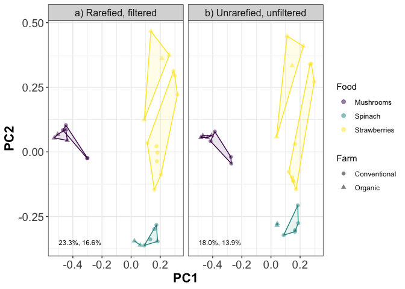

    # The overall trends are the same but there were some minor shifts. Also the rarefied/filtered dataset gets more % variation explained by the first 2 axes.

## Hierarchical Clustering

### Another option to examine community composition among your samples and treatments is to see how they cluster. You can already see how they cluster in the ordination plots, but this is another method that can be used.

    # Cluster according to Ward's D2. There are other methods available.
    # The input is a dissimilarity matrix. Here we'll use the Bray-Curtis one.
    h <- hclust(bc)

    # The default plot of the saved hclust object will immediately give you an overview of how the samples cluster. 
    # There are ways to clean up these plots and make them pretty and color by treatments but that won't be covered here.
    plot(h)

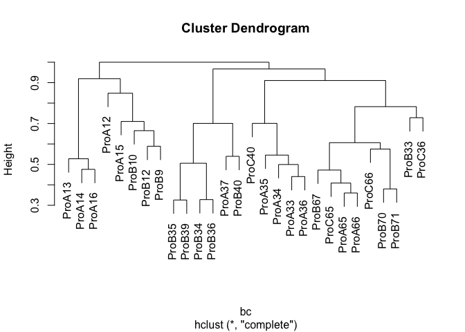

# TAXONOMIC ANALYSIS

## Indicator Taxa

### Let’s first check for indicator taxa for our grouping variables. We will try two methods, SIMPER and MULTIPATT. SIMPER will list how much each ASV contributes to dissimilarity among groups. MULTIPATT will list indicators for each individual group as well as combinations of groups. These methods use a large amount of computer memory and can sometimes take a while or max out your computer, depending on the dataset size. It will run faster/better on a server or if you just run it on the most abundant taxa instead of tens of thousands of ASVs. In this case, this is a simple dataset and we won’t have any problems.

    # SIMPER (list how much each ASV contributes to dissimilarity among groups)
    sim <- simper(t(input_filt_rar$data_loaded), 
                  input_filt_rar$map_loaded$Sample_type)
    s <- summary(sim)
    # Let's look at the top 5 contributing to dissimilarity between mushrooms and strawberries/spinach
    head(s$Mushrooms_Strawberries, n = 5)

    ##             average         sd     ratio     ava          avb    cumsum     p
    ## OTU_5339 0.15510254 0.15712746 0.9871129   0.000 294.38461538 0.1579854 0.035
    ## OTU_1763 0.07767285 0.10876583 0.7141292   0.750 147.53846154 0.2371020 0.205
    ## OTU_7240 0.07004843 0.04265811 1.6420893 133.875   0.92307692 0.3084524 0.001
    ## OTU_6975 0.05174982 0.05932183 0.8723571   3.625 101.30769231 0.3611641 1.000
    ## OTU_8870 0.04310712 0.06974072 0.6181054  81.875   0.07692308 0.4050725 0.001

    head(s$Mushrooms_Spinach, n = 5)

    ##             average         sd     ratio     ava       avb    cumsum     p
    ## OTU_6975 0.20191367 0.06950675 2.9049506   3.625 386.85714 0.2172342 0.001
    ## OTU_6245 0.06529429 0.04392433 1.4865178   5.500 129.42857 0.2874828 0.001
    ## OTU_7240 0.05378782 0.04099386 1.3120945 133.875  44.57143 0.3453519 0.038
    ## OTU_8870 0.04277999 0.06993490 0.6117117  81.875   1.00000 0.3913778 0.025
    ## OTU_9155 0.03562961 0.05730298 0.6217759  67.625   0.00000 0.4297109 0.005

    # average is the proportion contribution, cumsum is cumulative, ava and avb are mean sequence abundances per group.
    # in this case it looks like the top 5 ASVs are explaining a lot of the difference (~40%)

    # MULTIPATT (list ASVs associated with each group)
    # Groups can be individual treatments or groups of treatments
    set.seed(1223) # For reproducibility
    mp <- multipatt(t(input_filt_rar$data_loaded), 
                    input_filt_rar$map_loaded$Sample_type, 
                    func = "IndVal.g", 
                    control = how(nperm=999))
    summary(mp)

    ## 
    ##  Multilevel pattern analysis
    ##  ---------------------------
    ## 
    ##  Association function: IndVal.g
    ##  Significance level (alpha): 0.05
    ## 
    ##  Total number of species: 888
    ##  Selected number of species: 204 
    ##  Number of species associated to 1 group: 191 
    ##  Number of species associated to 2 groups: 13 
    ## 
    ##  List of species associated to each combination: 
    ## 
    ##  Group Mushrooms  #sps.  107 
    ##            stat p.value    
    ## OTU_7703  0.999   0.001 ***
    ## OTU_4891  0.935   0.001 ***
    ## OTU_6190  0.935   0.001 ***
    ## OTU_7523  0.935   0.001 ***
    ## OTU_9155  0.935   0.001 ***
    ## OTU_8870  0.929   0.004 ** 
    ## OTU_3033  0.877   0.001 ***
    ## OTU_3636  0.866   0.001 ***
    ## OTU_8177  0.866   0.001 ***
    ## OTU_12181 0.866   0.001 ***
    ## OTU_8653  0.858   0.001 ***
    ## OTU_3785  0.846   0.002 ** 
    ## OTU_1478  0.791   0.001 ***
    ## OTU_1527  0.791   0.001 ***
    ## OTU_1730  0.791   0.004 ** 
    ## OTU_3432  0.791   0.002 ** 
    ## OTU_4062  0.791   0.001 ***
    ## OTU_6747  0.791   0.002 ** 
    ## OTU_8874  0.791   0.002 ** 
    ## OTU_9608  0.791   0.002 ** 
    ## OTU_10514 0.791   0.001 ***
    ## OTU_11482 0.791   0.002 ** 
    ## OTU_11952 0.791   0.002 ** 
    ## OTU_12614 0.791   0.001 ***
    ## OTU_6760  0.790   0.002 ** 
    ## OTU_5927  0.779   0.011 *  
    ## OTU_2395  0.776   0.002 ** 
    ## OTU_13366 0.742   0.006 ** 
    ## OTU_995   0.707   0.001 ***
    ## OTU_1295  0.707   0.004 ** 
    ## OTU_2241  0.707   0.007 ** 
    ## OTU_2402  0.707   0.006 ** 
    ## OTU_2428  0.707   0.004 ** 
    ## OTU_2797  0.707   0.006 ** 
    ## OTU_3563  0.707   0.004 ** 
    ## OTU_3804  0.707   0.005 ** 
    ## OTU_4354  0.707   0.006 ** 
    ## OTU_4456  0.707   0.006 ** 
    ## OTU_4688  0.707   0.007 ** 
    ## OTU_5186  0.707   0.006 ** 
    ## OTU_7569  0.707   0.004 ** 
    ## OTU_9903  0.707   0.003 ** 
    ## OTU_10146 0.707   0.006 ** 
    ## OTU_10284 0.707   0.008 ** 
    ## OTU_10759 0.707   0.006 ** 
    ## OTU_10769 0.707   0.006 ** 
    ## OTU_11299 0.707   0.006 ** 
    ## OTU_12424 0.707   0.005 ** 
    ## OTU_12968 0.707   0.004 ** 
    ## OTU_5354  0.697   0.009 ** 
    ## OTU_10979 0.690   0.021 *  
    ## OTU_9742  0.644   0.041 *  
    ## OTU_229   0.612   0.031 *  
    ## OTU_242   0.612   0.028 *  
    ## OTU_294   0.612   0.026 *  
    ## OTU_378   0.612   0.028 *  
    ## OTU_860   0.612   0.023 *  
    ## OTU_1029  0.612   0.028 *  
    ## OTU_1160  0.612   0.024 *  
    ## OTU_1542  0.612   0.025 *  
    ## OTU_1702  0.612   0.024 *  
    ## OTU_1709  0.612   0.028 *  
    ## OTU_1931  0.612   0.025 *  
    ## OTU_2039  0.612   0.028 *  
    ## OTU_2270  0.612   0.034 *  
    ## OTU_2608  0.612   0.028 *  
    ## OTU_2798  0.612   0.027 *  
    ## OTU_2900  0.612   0.028 *  
    ## OTU_2953  0.612   0.029 *  
    ## OTU_3052  0.612   0.031 *  
    ## OTU_3189  0.612   0.025 *  
    ## OTU_3888  0.612   0.028 *  
    ## OTU_4413  0.612   0.028 *  
    ## OTU_5096  0.612   0.024 *  
    ## OTU_5444  0.612   0.032 *  
    ## OTU_5510  0.612   0.026 *  
    ## OTU_6041  0.612   0.034 *  
    ## OTU_6059  0.612   0.030 *  
    ## OTU_6387  0.612   0.023 *  
    ## OTU_6535  0.612   0.027 *  
    ## OTU_6801  0.612   0.028 *  
    ## OTU_8687  0.612   0.028 *  
    ## OTU_8801  0.612   0.028 *  
    ## OTU_8859  0.612   0.028 *  
    ## OTU_9313  0.612   0.028 *  
    ## OTU_9890  0.612   0.032 *  
    ## OTU_10038 0.612   0.024 *  
    ## OTU_10315 0.612   0.028 *  
    ## OTU_10477 0.612   0.028 *  
    ## OTU_10500 0.612   0.028 *  
    ## OTU_10656 0.612   0.027 *  
    ## OTU_11129 0.612   0.031 *  
    ## OTU_11269 0.612   0.026 *  
    ## OTU_11456 0.612   0.028 *  
    ## OTU_11562 0.612   0.031 *  
    ## OTU_11584 0.612   0.037 *  
    ## OTU_11773 0.612   0.026 *  
    ## OTU_12146 0.612   0.030 *  
    ## OTU_12885 0.612   0.031 *  
    ## OTU_13134 0.612   0.034 *  
    ## OTU_13180 0.612   0.026 *  
    ## OTU_13398 0.612   0.032 *  
    ## OTU_1844  0.603   0.022 *  
    ## OTU_11078 0.599   0.038 *  
    ## OTU_1882  0.587   0.037 *  
    ## OTU_7606  0.587   0.042 *  
    ## OTU_8713  0.583   0.043 *  
    ## 
    ##  Group Spinach  #sps.  58 
    ##            stat p.value    
    ## OTU_2655  1.000   0.001 ***
    ## OTU_4732  0.978   0.001 ***
    ## OTU_8281  0.972   0.001 ***
    ## OTU_1150  0.955   0.001 ***
    ## OTU_508   0.951   0.001 ***
    ## OTU_320   0.939   0.001 ***
    ## OTU_719   0.913   0.001 ***
    ## OTU_8799  0.886   0.001 ***
    ## OTU_1642  0.845   0.001 ***
    ## OTU_7290  0.845   0.001 ***
    ## OTU_13238 0.831   0.001 ***
    ## OTU_11334 0.823   0.001 ***
    ## OTU_4398  0.818   0.002 ** 
    ## OTU_10433 0.796   0.012 *  
    ## OTU_10513 0.789   0.002 ** 
    ## OTU_12329 0.787   0.001 ***
    ## OTU_1618  0.778   0.002 ** 
    ## OTU_12015 0.773   0.001 ***
    ## OTU_3608  0.756   0.003 ** 
    ## OTU_7030  0.756   0.002 ** 
    ## OTU_9070  0.756   0.003 ** 
    ## OTU_11070 0.756   0.004 ** 
    ## OTU_12275 0.756   0.002 ** 
    ## OTU_9708  0.718   0.003 ** 
    ## OTU_7733  0.715   0.014 *  
    ## OTU_5443  0.710   0.009 ** 
    ## OTU_2146  0.697   0.007 ** 
    ## OTU_1626  0.655   0.012 *  
    ## OTU_2178  0.655   0.006 ** 
    ## OTU_2250  0.655   0.013 *  
    ## OTU_3148  0.655   0.011 *  
    ## OTU_3695  0.655   0.014 *  
    ## OTU_3696  0.655   0.012 *  
    ## OTU_5320  0.655   0.016 *  
    ## OTU_5514  0.655   0.010 ** 
    ## OTU_5578  0.655   0.005 ** 
    ## OTU_7854  0.655   0.012 *  
    ## OTU_9378  0.655   0.017 *  
    ## OTU_10070 0.655   0.016 *  
    ## OTU_11796 0.655   0.010 ** 
    ## OTU_10845 0.631   0.005 ** 
    ## OTU_3614  0.631   0.022 *  
    ## OTU_6661  0.628   0.019 *  
    ## OTU_1960  0.622   0.024 *  
    ## OTU_2617  0.620   0.025 *  
    ## OTU_7365  0.603   0.025 *  
    ## OTU_367   0.535   0.050 *  
    ## OTU_1821  0.535   0.044 *  
    ## OTU_3843  0.535   0.043 *  
    ## OTU_4741  0.535   0.045 *  
    ## OTU_7297  0.535   0.050 *  
    ## OTU_7881  0.535   0.043 *  
    ## OTU_8958  0.535   0.043 *  
    ## OTU_10494 0.535   0.050 *  
    ## OTU_11077 0.535   0.050 *  
    ## OTU_12457 0.535   0.050 *  
    ## OTU_12665 0.535   0.050 *  
    ## OTU_12730 0.535   0.045 *  
    ## 
    ##  Group Strawberries  #sps.  26 
    ##            stat p.value   
    ## OTU_2080  0.784   0.003 **
    ## OTU_1763  0.781   0.011 * 
    ## OTU_989   0.734   0.009 **
    ## OTU_3427  0.734   0.012 * 
    ## OTU_4804  0.734   0.014 * 
    ## OTU_7411  0.734   0.012 * 
    ## OTU_5339  0.733   0.009 **
    ## OTU_10680 0.731   0.015 * 
    ## OTU_10922 0.730   0.012 * 
    ## OTU_9761  0.714   0.029 * 
    ## OTU_2502  0.679   0.019 * 
    ## OTU_4013  0.679   0.021 * 
    ## OTU_4304  0.679   0.018 * 
    ## OTU_6219  0.638   0.041 * 
    ## OTU_6817  0.638   0.034 * 
    ## OTU_13306 0.635   0.038 * 
    ## OTU_6225  0.632   0.035 * 
    ## OTU_370   0.620   0.024 * 
    ## OTU_1683  0.620   0.048 * 
    ## OTU_1689  0.620   0.031 * 
    ## OTU_5122  0.620   0.035 * 
    ## OTU_6276  0.620   0.037 * 
    ## OTU_7337  0.620   0.036 * 
    ## OTU_8990  0.620   0.034 * 
    ## OTU_10876 0.620   0.041 * 
    ## OTU_12316 0.620   0.035 * 
    ## 
    ##  Group Mushrooms+Spinach  #sps.  4 
    ##            stat p.value    
    ## OTU_7240  0.997   0.001 ***
    ## OTU_13300 0.816   0.002 ** 
    ## OTU_5323  0.775   0.004 ** 
    ## OTU_5568  0.666   0.037 *  
    ## 
    ##  Group Spinach+Strawberries  #sps.  9 
    ##            stat p.value    
    ## OTU_6975  0.996   0.001 ***
    ## OTU_6245  0.984   0.001 ***
    ## OTU_11811 0.952   0.001 ***
    ## OTU_64    0.894   0.001 ***
    ## OTU_1275  0.806   0.001 ***
    ## OTU_7928  0.806   0.002 ** 
    ## OTU_9230  0.707   0.033 *  
    ## OTU_908   0.671   0.047 *  
    ## OTU_13190 0.671   0.049 *  
    ## ---
    ## Signif. codes:  0 '***' 0.001 '**' 0.01 '*' 0.05 '.' 0.1 ' ' 1

    # Now lets use a custom function for plotting just 1 group indicators and choosing p value and indicator value cutoffs.
    # Rerun the multipatt with the r.g func.
    set.seed(1223) # For reproducibility
    mp <- multipatt(t(input_filt_rar$data_loaded), 
                    input_filt_rar$map_loaded$Sample_type, 
                    func = "r.g", 
                    control = how(nperm=999))

    # This function was built with an 8th taxonomy column containing the ASV ID. Make here.
    input_filt_rar$taxonomy_loaded$taxonomy8 <- rownames(input_filt_rar$taxonomy_loaded)

    # It takes a summarized taxonomy dataframe, made like this.
    tax_sum_asv <- summarize_taxonomy(input_filt_rar, level = 8, report_higher_tax = FALSE)

    # The group must be a factor
    input_filt_rar$map_loaded$Sample_type <- as.factor(input_filt_rar$map_loaded$Sample_type) 

    # Run the function.
    plot_multipatt_asv(mp_obj = mp, 
                       input = input_filt_rar,
                       tax_sum = tax_sum_asv,
                       group = "Sample_type",
                       filter = FALSE,
                       abund = "% Rel. Abund.",
                       qcut = 0.05, # Adjusted p value< 0.05
                       rcut = 0.5) # Can change r cutoff to be more or less selective

    ## Warning: In `margin()`, the argument `t` should have length 1, not length 4.
    ## ℹ Argument get(s) truncated to length 1.
    ## In `margin()`, the argument `t` should have length 1, not length 4.
    ## ℹ Argument get(s) truncated to length 1.
    ## In `margin()`, the argument `t` should have length 1, not length 4.
    ## ℹ Argument get(s) truncated to length 1.
    ## In `margin()`, the argument `t` should have length 1, not length 4.
    ## ℹ Argument get(s) truncated to length 1.
    ## In `margin()`, the argument `t` should have length 1, not length 4.
    ## ℹ Argument get(s) truncated to length 1.

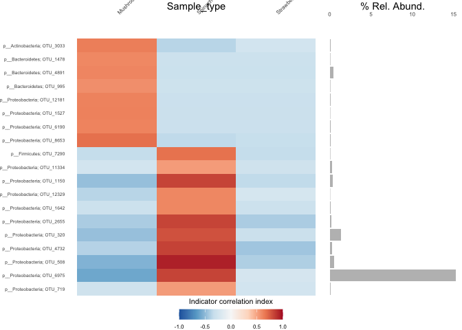

    # This will plot the ASVs that passed the cutoffs. It will plot how correlated they are with a group as well as their % relative abundance. It will state the phylum and ASV ID.

## OTU/ASV Specific functions

    # Let's look at the top taxa across samples (Can change the number you want seen)
    return_top_taxa(input = input_filt_rar, number_taxa = 10)

    ##             taxonomy1         taxonomy2              taxonomy3             taxonomy4
    ## OTU_6975  k__Bacteria p__Proteobacteria c__Gammaproteobacteria  o__Enterobacteriales
    ## OTU_5339  k__Bacteria p__Proteobacteria c__Gammaproteobacteria  o__Enterobacteriales
    ## OTU_1763  k__Bacteria     p__Firmicutes             c__Bacilli         o__Bacillales
    ## OTU_6245  k__Bacteria p__Proteobacteria c__Gammaproteobacteria  o__Enterobacteriales
    ## OTU_7240  k__Bacteria p__Proteobacteria c__Gammaproteobacteria    o__Pseudomonadales
    ## OTU_8870  k__Bacteria  p__Bacteroidetes      c__Flavobacteriia   o__Flavobacteriales
    ## OTU_9155  k__Bacteria  p__Bacteroidetes    c__Sphingobacteriia o__Sphingobacteriales
    ## OTU_10680 k__Bacteria p__Proteobacteria c__Alphaproteobacteria   o__Sphingomonadales
    ## OTU_5927  k__Bacteria  p__Bacteroidetes    c__Sphingobacteriia o__Sphingobacteriales
    ## OTU_320   k__Bacteria p__Proteobacteria c__Gammaproteobacteria  o__Enterobacteriales
    ##                        taxonomy5           taxonomy6  taxonomy7 taxonomy8
    ## OTU_6975   f__Enterobacteriaceae          g__Erwinia        s__  OTU_6975
    ## OTU_5339   f__Enterobacteriaceae         g__Buchnera        s__  OTU_5339
    ## OTU_1763          f__Bacillaceae                 g__        s__  OTU_1763
    ## OTU_6245   f__Enterobacteriaceae                 g__        s__  OTU_6245
    ## OTU_7240     f__Pseudomonadaceae      g__Pseudomonas        s__  OTU_7240
    ## OTU_8870      f__[Weeksellaceae] g__Chryseobacterium        s__  OTU_8870
    ## OTU_9155  f__Sphingobacteriaceae       g__Pedobacter        s__  OTU_9155
    ## OTU_10680   f__Sphingomonadaceae     g__Sphingomonas        s__ OTU_10680
    ## OTU_5927  f__Sphingobacteriaceae g__Sphingobacterium s__faecium  OTU_5927
    ## OTU_320    f__Enterobacteriaceae          g__Erwinia        s__   OTU_320

    # Calculates the top taxa based on number of counts - taking the row means for each OTU

    # What taxa are common? Give them rarefied input, then level = "what level we want to summarize our information for". Check input_filt_rar$taxonomy_loaded for the levels. level 2 is phylum level
    tax_sum_phyla <- summarize_taxonomy(input_filt_rar, level = 2, report_higher_tax = FALSE)
    #level taxa=false- just look at that level, not at whole taxonomic classification

    # How many phyla can we detect in this dataset
    nrow(tax_sum_phyla)

    ## [1] 11

    # Check the most abundant phyla across dataset
    tax_sum_phyla_Means <- sort(rowMeans(tax_sum_phyla), decreasing = T)

    # This is now sorted from most abundant to least abundant, based on means across all samples
    # Check the top 5 phyla
    tax_sum_phyla_Means[1:5]

    ## p__Proteobacteria  p__Bacteroidetes     p__Firmicutes p__Actinobacteria 
    ##       0.722038236       0.135142255       0.110680415       0.029730543 
    ##    p__Chloroflexi 
    ##       0.001392443

    # Now lets try summarizing at the family level (level 5)
    tax_sum_families <- summarize_taxonomy(input_filt_rar, level = 5, report_higher_tax = FALSE)
    head(tax_sum_families)

    ##                             ProA12      ProA13      ProA14      ProA15    ProA16
    ## f__                    0.012644889 0.002107482 0.001053741 0.038988409 0.0000000
    ## f__[Chromatiaceae]     0.002107482 0.000000000 0.000000000 0.002107482 0.0000000
    ## f__[Exiguobacteraceae] 0.053740780 0.002107482 0.000000000 0.000000000 0.0000000
    ## f__[Fimbriimonadaceae] 0.000000000 0.000000000 0.000000000 0.001053741 0.0000000
    ## f__[Weeksellaceae]     0.010537408 0.081138040 0.516332982 0.005268704 0.1928346
    ## f__Acetobacteraceae    0.000000000 0.000000000 0.000000000 0.000000000 0.0000000
    ##                             ProA33      ProA34      ProA35      ProA36 ProA37
    ## f__                    0.008429926 0.002107482 0.002107482 0.002107482      0
    ## f__[Chromatiaceae]     0.000000000 0.000000000 0.000000000 0.000000000      0
    ## f__[Exiguobacteraceae] 0.000000000 0.000000000 0.000000000 0.000000000      0
    ## f__[Fimbriimonadaceae] 0.000000000 0.000000000 0.000000000 0.000000000      0
    ## f__[Weeksellaceae]     0.001053741 0.000000000 0.001053741 0.000000000      0
    ## f__Acetobacteraceae    0.022128556 0.001053741 0.000000000 0.000000000      0
    ##                             ProA65      ProA66      ProB10      ProB12      ProB33
    ## f__                    0.000000000 0.000000000 0.014752371 0.006322445 0.000000000
    ## f__[Chromatiaceae]     0.000000000 0.000000000 0.005268704 0.053740780 0.001053741
    ## f__[Exiguobacteraceae] 0.033719705 0.051633298 0.007376185 0.012644889 0.000000000
    ## f__[Fimbriimonadaceae] 0.000000000 0.000000000 0.000000000 0.000000000 0.000000000
    ## f__[Weeksellaceae]     0.003161222 0.001053741 0.106427819 0.011591149 0.002107482
    ## f__Acetobacteraceae    0.000000000 0.000000000 0.000000000 0.000000000 0.028451001
    ##                            ProB34      ProB35     ProB36     ProB39      ProB40
    ## f__                    0.00000000 0.000000000 0.00000000 0.00000000 0.000000000
    ## f__[Chromatiaceae]     0.00000000 0.000000000 0.00000000 0.00000000 0.000000000
    ## f__[Exiguobacteraceae] 0.00000000 0.000000000 0.00000000 0.00000000 0.000000000
    ## f__[Fimbriimonadaceae] 0.00000000 0.000000000 0.00000000 0.00000000 0.000000000
    ## f__[Weeksellaceae]     0.00000000 0.000000000 0.00000000 0.01159115 0.000000000
    ## f__Acetobacteraceae    0.02212856 0.006322445 0.01791359 0.00000000 0.001053741
    ##                             ProB67      ProB70      ProB71       ProB9      ProC36
    ## f__                    0.000000000 0.002107482 0.000000000 0.004214963 0.004214963
    ## f__[Chromatiaceae]     0.000000000 0.000000000 0.000000000 0.024236038 0.000000000
    ## f__[Exiguobacteraceae] 0.027397260 0.057955743 0.061116965 0.068493151 0.002107482
    ## f__[Fimbriimonadaceae] 0.000000000 0.000000000 0.000000000 0.000000000 0.000000000
    ## f__[Weeksellaceae]     0.002107482 0.003161222 0.003161222 0.024236038 0.000000000
    ## f__Acetobacteraceae    0.000000000 0.000000000 0.000000000 0.000000000 0.000000000
    ##                             ProC40      ProC65      ProC66
    ## f__                    0.001053741 0.000000000 0.000000000
    ## f__[Chromatiaceae]     0.000000000 0.000000000 0.000000000
    ## f__[Exiguobacteraceae] 0.000000000 0.005268704 0.002107482
    ## f__[Fimbriimonadaceae] 0.000000000 0.000000000 0.000000000
    ## f__[Weeksellaceae]     0.000000000 0.000000000 0.000000000
    ## f__Acetobacteraceae    0.000000000 0.000000000 0.000000000

## Other useful plotting and analysis functions

### Base mctoolsR has some other nice functions for running statistical tests on taxonomic abundances as well as plotting heatmaps and stacked bar plots. We also demonstrate some customizations on the base functions. For more information on mctoolsR functions, see the tutorial at <https://github.com/leffj/mctoolsr>.

    # Summarize at family level. Choose different levels with the level argument
    tax_sum_families <- summarize_taxonomy(input_filt_rar, level = 5, report_higher_tax = FALSE)

    # Default heatmap
    plot_ts_heatmap(tax_sum_families, 
                    input_filt_rar$map_loaded, 
                    0.01, 
                    'Sample_type')

    ## Warning: `mutate_()` was deprecated in dplyr 0.7.0.
    ## ℹ Please use `mutate()` instead.
    ## ℹ See vignette('programming') for more help
    ## ℹ The deprecated feature was likely used in the mctoolsr package.
    ##   Please report the issue at <https://github.com/leffj/mctoolsr/issues>.
    ## This warning is displayed once every 8 hours.
    ## Call `lifecycle::last_lifecycle_warnings()` to see where this warning was generated.

    ## Warning: Using `size` aesthetic for lines was deprecated in ggplot2 3.4.0.
    ## ℹ Please use `linewidth` instead.
    ## ℹ The deprecated feature was likely used in the mctoolsr package.
    ##   Please report the issue at <https://github.com/leffj/mctoolsr/issues>.
    ## This warning is displayed once every 8 hours.
    ## Call `lifecycle::last_lifecycle_warnings()` to see where this warning was generated.

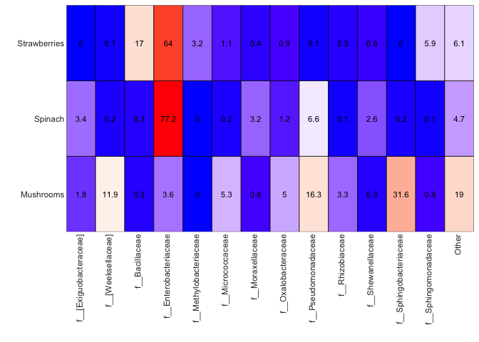

    # Add some customization
    plot_ts_heatmap(tax_sum_families, 
                    input_filt_rar$map_loaded, 
                    0.01, 
                    'Sample_type',
                    rev_taxa = T) +
      coord_flip() +
      theme(axis.text.x = element_text(size = 12, angle = 45, vjust = 1))

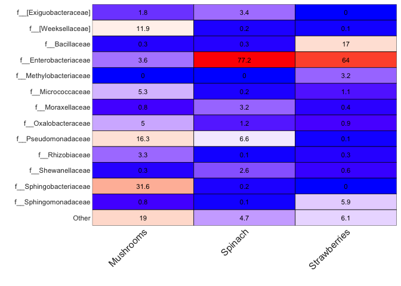

    # Default (choose how many taxa you want with num_taxa)
    plot_taxa_bars(tax_sum_families,
                   input_filt_rar$map_loaded,
                   "Sample_type",
                   num_taxa = 10)

    ## Warning: `summarise_()` was deprecated in dplyr 0.7.0.
    ## ℹ Please use `summarise()` instead.
    ## ℹ The deprecated feature was likely used in the mctoolsr package.
    ##   Please report the issue at <https://github.com/leffj/mctoolsr/issues>.
    ## This warning is displayed once every 8 hours.
    ## Call `lifecycle::last_lifecycle_warnings()` to see where this warning was generated.

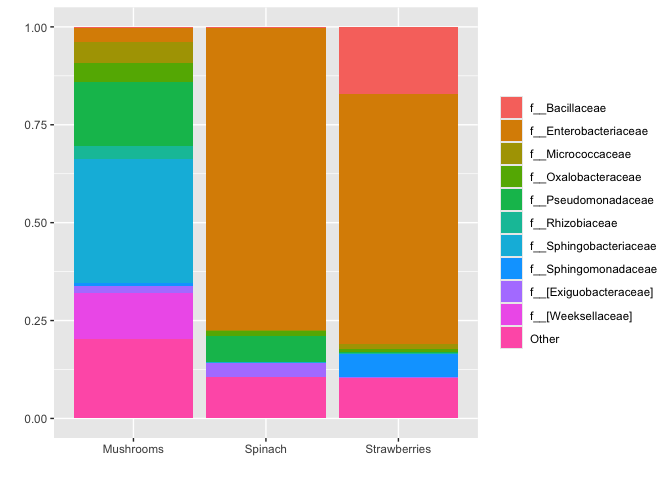

    # Add some customization
    plot_taxa_bars(tax_sum_families,
                   input_filt_rar$map_loaded,
                   "Sample_type",
                   num_taxa = 10) +
      labs(x = "Sample Type", y = "Relative Abundance", fill = "Family") +
      theme_bw() +
      theme(axis.title = element_text(face = "bold", size = 16), 
            axis.text = element_text(size = 14))

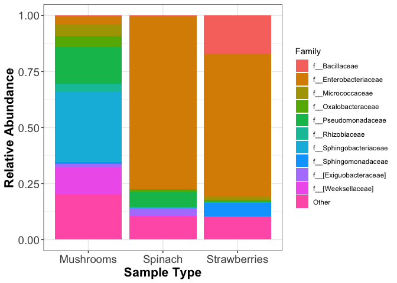

    # Add even more customization. plot_taxa_bars has a data_only argument. So you can save the dataset created and then write your own plot!
    bars <- plot_taxa_bars(tax_sum_families,
                           input_filt_rar$map_loaded,
                           "Sample_type",
                           num_taxa = 10,
                           data_only = TRUE)
    ggplot(bars, aes(group_by, mean_value, fill = taxon)) +
      geom_bar(stat = "identity", colour = "black", linewidth = 0.25) +
      labs(x = "Sample Type", y = "Relative Abundance", fill = "Family") +
      scale_fill_brewer(palette = "Paired") +
      theme_bw() +
      theme(axis.title = element_text(face = "bold", size = 16), 
            axis.text = element_text(size = 14))

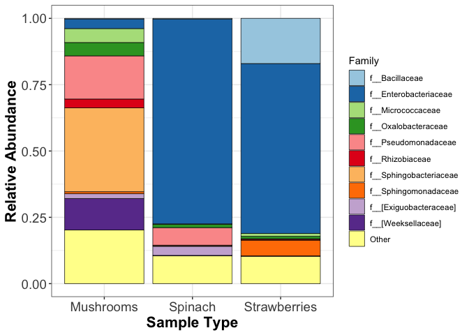

    # Different style - classic theme, no black lines between taxa.
    ggplot(bars, aes(group_by, mean_value, fill = taxon)) +
      geom_bar(stat = "identity", linewidth = 0.25) +
      labs(x = "Sample Type", y = "Relative Abundance", fill = "Family") +
      scale_fill_brewer(palette = "Paired") +
      theme_classic() +
      theme(axis.title = element_text(face = "bold", size = 16), 
            axis.text = element_text(size = 14))

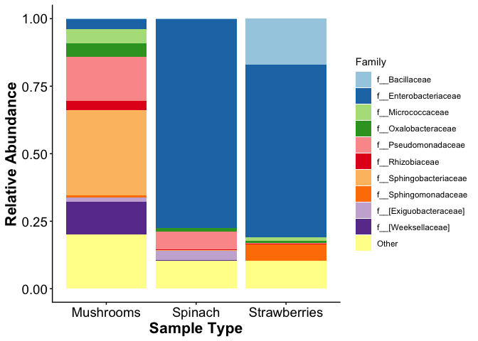

    # Now try a cliffplot! This is a custom function by Cliff Bueno de Mesquita that serves as a nice but quick overview of the top taxa at different levels. The function is in the GitHub repository and was imported with the source() function in the setup portion of this tutorial. You can ignore the warnings, which have to do with whether or not unclassified taxa were in the top 12 of a particular taxonomic level. It was also made with a SILVA version that writes Unclassified instead of unclassified.
    cliffplot_taxa_bars(input = input_filt_rar, level = 1, variable = "Sample_type")

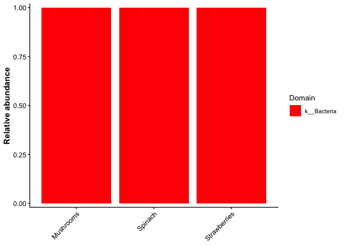

    cliffplot_taxa_bars(input = input_filt_rar, level = 2, variable = "Sample_type")

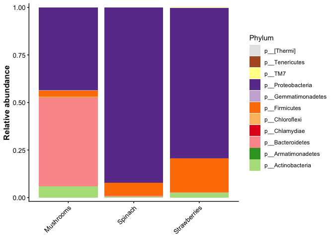

    cliffplot_taxa_bars(input = input_filt_rar, level = 3, variable = "Sample_type")

    ## Warning: There were 3 warnings in `mutate()`.
    ## The first warning was:
    ## ℹ In argument: `taxon = fct_relevel(taxon, "Unclassified", after = Inf)`.
    ## ℹ In group 1: `group_by = Mushrooms`.
    ## Caused by warning:
    ## ! 1 unknown level in `f`: Unclassified
    ## ℹ Run `dplyr::last_dplyr_warnings()` to see the 2 remaining warnings.

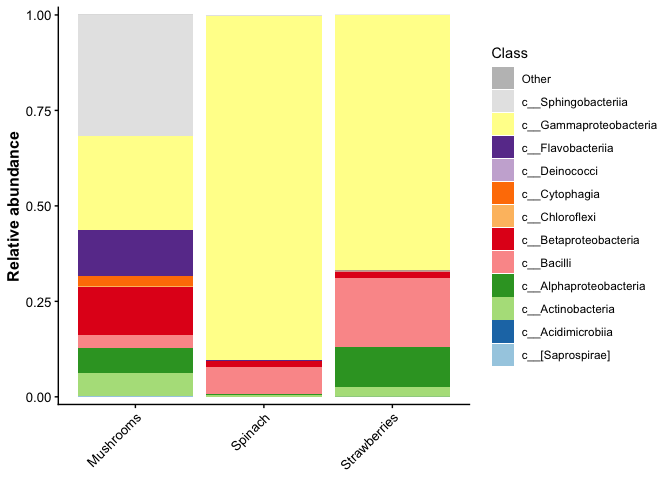

    cliffplot_taxa_bars(input = input_filt_rar, level = 4, variable = "Sample_type")

    ## Warning: There were 3 warnings in `mutate()`.
    ## The first warning was:
    ## ℹ In argument: `taxon = fct_relevel(taxon, "Unclassified", after = Inf)`.
    ## ℹ In group 1: `group_by = Mushrooms`.
    ## Caused by warning:
    ## ! 1 unknown level in `f`: Unclassified
    ## ℹ Run `dplyr::last_dplyr_warnings()` to see the 2 remaining warnings.

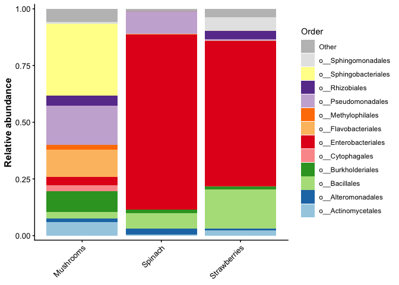

    cliffplot_taxa_bars(input = input_filt_rar, level = 5, variable = "Sample_type")

    ## Warning: There were 3 warnings in `mutate()`.
    ## The first warning was:
    ## ℹ In argument: `taxon = fct_relevel(taxon, "Unclassified", after = Inf)`.
    ## ℹ In group 1: `group_by = Mushrooms`.
    ## Caused by warning:
    ## ! 1 unknown level in `f`: Unclassified
    ## ℹ Run `dplyr::last_dplyr_warnings()` to see the 2 remaining warnings.

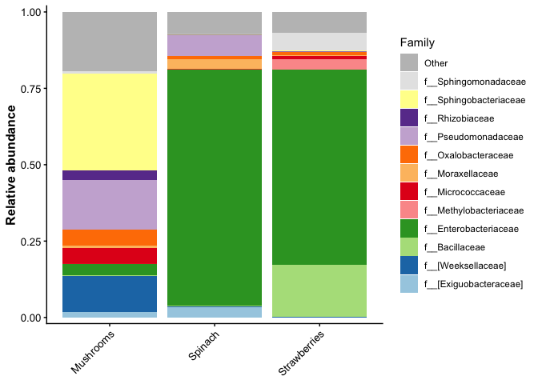

    cliffplot_taxa_bars(input = input_filt_rar, level = 6, variable = "Sample_type")

    ## Warning: There were 3 warnings in `mutate()`.
    ## The first warning was:
    ## ℹ In argument: `taxon = fct_relevel(taxon, "Unclassified", after = Inf)`.
    ## ℹ In group 1: `group_by = Mushrooms`.
    ## Caused by warning:
    ## ! 1 unknown level in `f`: Unclassified
    ## ℹ Run `dplyr::last_dplyr_warnings()` to see the 2 remaining warnings.

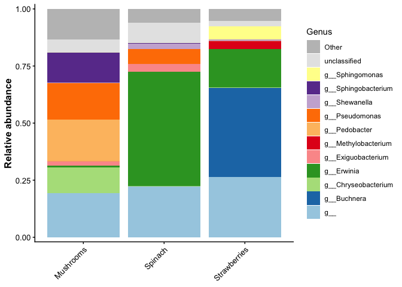

    cliffplot_taxa_bars(input = input_filt_rar, level = 7, variable = "Sample_type")

    ## Warning: There were 3 warnings in `mutate()`.
    ## The first warning was:
    ## ℹ In argument: `taxon = fct_relevel(taxon, "Unclassified", after = Inf)`.
    ## ℹ In group 1: `group_by = Mushrooms`.
    ## Caused by warning:
    ## ! 1 unknown level in `f`: Unclassified
    ## ℹ Run `dplyr::last_dplyr_warnings()` to see the 2 remaining warnings.

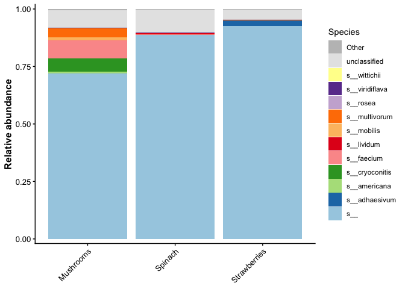

    cliffplot_taxa_bars(input = input_filt_rar, level = 8, variable = "Sample_type")

    ## Warning: There were 3 warnings in `mutate()`.
    ## The first warning was:
    ## ℹ In argument: `taxon = fct_relevel(taxon, "Unclassified", after = Inf)`.
    ## ℹ In group 1: `group_by = Mushrooms`.
    ## Caused by warning:
    ## ! 1 unknown level in `f`: Unclassified
    ## ℹ Run `dplyr::last_dplyr_warnings()` to see the 2 remaining warnings.

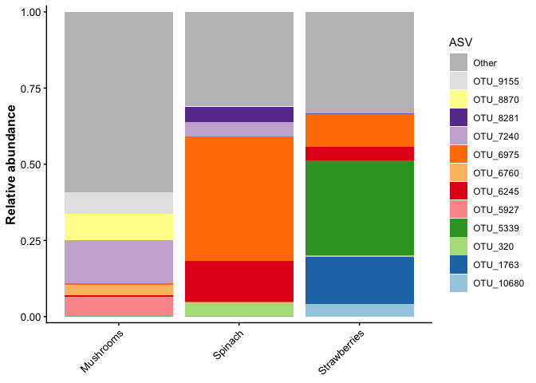

    # Add even more customization. Try a nested facet! These are great for parsing your taxonomy plot by different grouping variables. Set the sampleID as the grouping variable so a bar is made for each sample. Utilize the nested facets to show the differences among the actual grouping variables.

    # Make sampleID column
    input_filt_rar$map_loaded$sampleID <- rownames(input_filt_rar$map_loaded)

    # Summarize taxonomy. Let's do families.
    tax_sum_families <- summarize_taxonomy(input_filt_rar, level = 5, report_higher_tax = FALSE)

    # Get the plotting data. We'll also join the rest of map_loaded.
    bars <- plot_taxa_bars(tax_sum_families,
                           input_filt_rar$map_loaded,
                           "sampleID",
                           num_taxa = 12,
                           data_only = TRUE) %>%
      mutate(taxon = fct_rev(taxon)) %>%
      left_join(., input_filt_rar$map_loaded, by = c("group_by" = "sampleID"))

    # Run stats and add an asterisk to their name in the legend if significantly affected by treatment
    fam_stats <- taxa_summary_by_sample_type(tax_sum_families, 
                                             input_filt_rar$map_loaded, 
                                             type_header = 'Sample_type', 
                                             filter_level = 0.01, 
                                             test_type = 'KW') %>%
      filter(rownames(.) %in% bars$taxon) %>%
      arrange(desc(rownames(.))) %>%
      mutate(Sig = ifelse(pvalsFDR < 0.05, "Pfdr < 0.05", "Pfdr > 0.05")) %>%
      mutate(Star = ifelse(pvalsFDR < 0.05, "*", "")) %>%
      rownames_to_column(var = "taxon") %>%
      arrange(match(taxon, levels(bars$taxon))) %>%
      mutate(StarLab = paste(taxon, Star, sep = " "))

    # Plot
    ggplot(bars, aes(group_by, mean_value, fill = taxon)) +
      geom_bar(stat = "identity", linewidth = 0.25) +
      labs(x = "Sample Type", y = "Relative Abundance", fill = "Family") +
      scale_fill_manual(values = c("grey90", brewer.pal(12, "Paired")[12:1]),
                        labels = c("Other", fam_stats$StarLab)) +
      scale_y_continuous(expand = c(0.01, 0.01)) + 
      facet_nested(~ Farm_type + Sample_type, space = "free", scales = "free_x") +
      theme_classic() +
      theme(axis.title.y = element_text(face = "bold", size = 12),
            axis.title.x = element_blank(),
            axis.text.y = element_text(size = 10),
            axis.text.x = element_text(size = 8, angle = 90, hjust = 1, vjust = 0.5),
            axis.ticks.x = element_blank(),
            axis.line.x = element_blank(),
            strip.text = element_text(size = 6),
            strip.background = element_rect(linewidth = 0.2),
            axis.line.y = element_blank(),
            legend.margin = margin(0, 0, 0, 0, unit = "pt"),
            legend.box.margin = margin(0, 0, 0, 0, unit = "pt"),
            legend.key.size = unit(0.3, "cm"),
            panel.spacing.x = unit(c(0.2, 0.2, 0.4, 0.2, 0.2), "lines"))

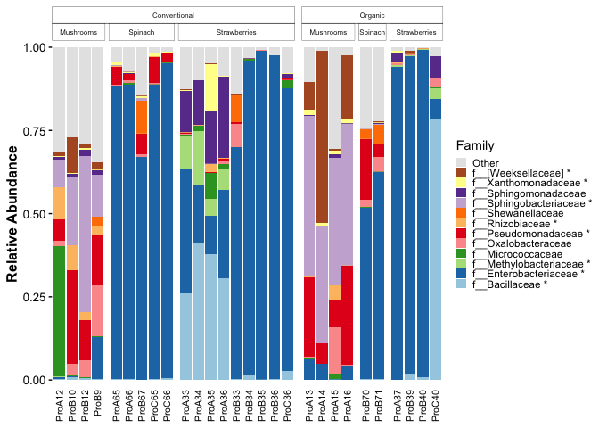

    # Test (run a Kruskal-Wallis test on all families with mean rel abund. > filter_level in at least one of the factor levels)
    taxa_summary_by_sample_type(tax_sum_families, 
                                input_filt_rar$map_loaded, 
                                type_header = 'Sample_type', 
                                filter_level = 0.05, 
                                test_type = 'KW')

    ##                               pvals     pvalsBon     pvalsFDR   Mushrooms     Spinach
    ## f__Pseudomonadaceae    1.462593e-05 0.0001170074 0.0001170074 0.162671233 0.066084600
    ## f__Sphingobacteriaceae 5.463909e-05 0.0004371127 0.0002185564 0.316122234 0.002258016
    ## f__[Weeksellaceae]     1.246078e-04 0.0009968628 0.0003322876 0.118545838 0.001806413
    ## f__Enterobacteriaceae  4.669735e-04 0.0037357879 0.0009339470 0.035958904 0.771940388
    ## f__Bacillaceae         1.761396e-02 0.1409117049 0.0281823410 0.002502634 0.002709619
    ## f__Oxalobacteraceae    6.710803e-02 0.5368642596 0.0894773766 0.050316122 0.012494355
    ## f__Sphingomonadaceae   7.023547e-02 0.5618837856 0.0802691122 0.007639621 0.000752672
    ## f__Micrococcaceae      5.776766e-01 4.6214126447 0.5776765806 0.052555321 0.001806413
    ##                        Strawberries
    ## f__Pseudomonadaceae    0.0014590257
    ## f__Sphingobacteriaceae 0.0004863419
    ## f__[Weeksellaceae]     0.0012158547
    ## f__Enterobacteriaceae  0.6403501662
    ## f__Bacillaceae         0.1703817784
    ## f__Oxalobacteraceae    0.0094026100
    ## f__Sphingomonadaceae   0.0594147686
    ## f__Micrococcaceae      0.0108616357

    # Or Wilcoxon for 2 levels (farm type)
    taxa_summary_by_sample_type(tax_sum_families, 
                                input_filt_rar$map_loaded, 
                                type_header = 'Farm_type', 
                                filter_level = 0.05, 
                                test_type = 'MW')

    ## Warning in wilcox.test.default(x = DATA[[1L]], y = DATA[[2L]], ...): cannot compute
    ## exact p-value with ties

    ## Warning in wilcox.test.default(x = DATA[[1L]], y = DATA[[2L]], ...): cannot compute
    ## exact p-value with ties
    ## Warning in wilcox.test.default(x = DATA[[1L]], y = DATA[[2L]], ...): cannot compute
    ## exact p-value with ties
    ## Warning in wilcox.test.default(x = DATA[[1L]], y = DATA[[2L]], ...): cannot compute
    ## exact p-value with ties
    ## Warning in wilcox.test.default(x = DATA[[1L]], y = DATA[[2L]], ...): cannot compute
    ## exact p-value with ties

    ##                            pvals  pvalsBon  pvalsFDR Conventional    Organic
    ## f__[Weeksellaceae]     0.1246744 0.6233719 0.6233719  0.009073879 0.08134879
    ## f__Bacillaceae         0.1410588 0.7052939 0.3526469  0.079674511 0.08198103
    ## f__Sphingobacteriaceae 0.3120693 1.5603463 0.5201154  0.049994146 0.16512118
    ## f__Enterobacteriaceae  0.5330298 2.6651492 0.6662873  0.543730242 0.42286617
    ## f__Pseudomonadaceae    0.6118674 3.0593371 0.6118674  0.048823323 0.09041096
